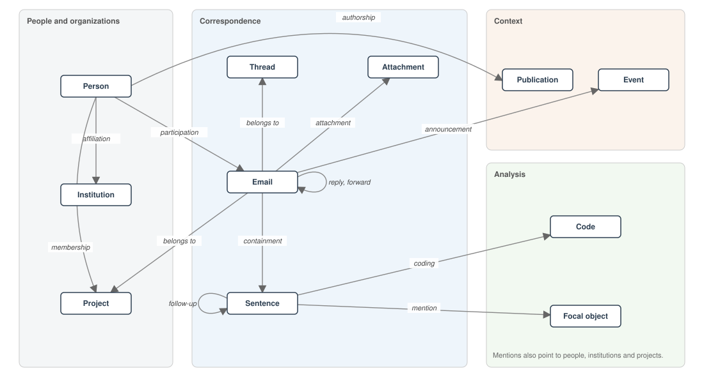
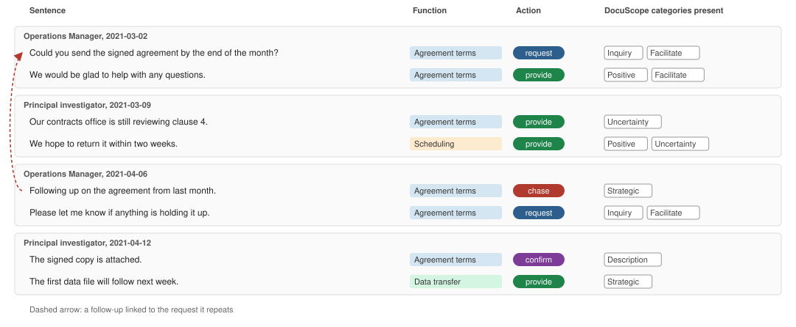
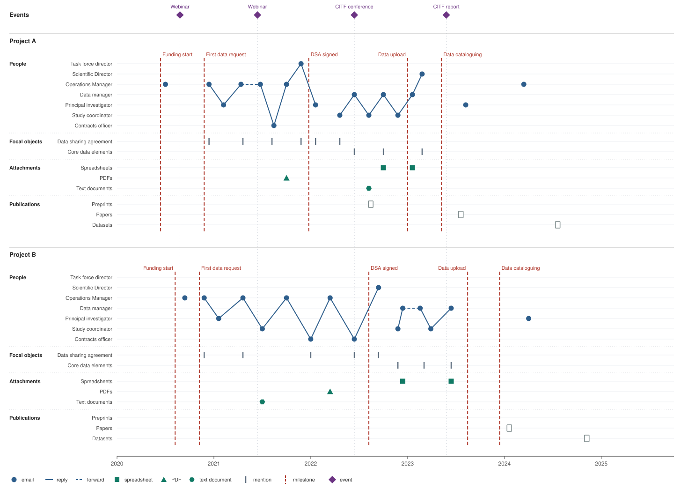
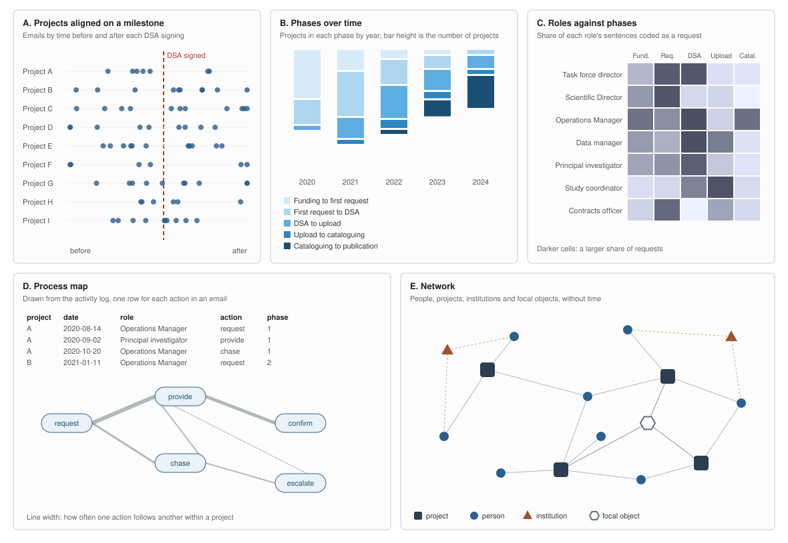

# Summary

The call on 13 November 2026 with David and Ian moved the CITF email work from tagging single emails to studying each project as a sequence of emails across its phases. This document reorganizes the work around that shift, directed toward the CIHR Project Grant application due March 3, 2027 (@sec-grant).

The work falls into four workstreams (@sec-workstreams). Preparing the corpus builds the study emails, their metadata, authored sentences and de-identified text into one corpus, with a graph of people, projects, focal objects and events around it. Coding rhetoric, functions and actions labels each sentence with three independent kinds of codes. Relating rhetoric, functions and actions brings the codes together, first with each other and then with role, phase and the course of each project. The grant builds on the earlier applications and on this work.

The data sit in node and edge tables with an activity log (@sec-model). Every view reads from those tables, whether it shows one thread for close reading or draws comparisons across projects (@sec-views). The workstreams map onto folders in the `CITF-emails` repository (@sec-repo), and the corpus preparation done within the DocuScope assessment moves to `corpus/`. The next steps are in @sec-next.

# Workstreams {#sec-workstreams}

The work falls into four workstreams. Preparing the corpus produces the emails, zones, sentences, de-identified text, nodes and edges that other workstreams read. Coding rhetoric, functions and actions labels the authored text, and relating rhetoric, functions and actions compares the three kinds of codes by sentence and by project. The CIHR Project Grant, Spring 2027 application draws its questions and methods from all of the above.

## Preparing the corpus {#sec-corpus}

The corpus is the table of emails, and the zones, links, names and sentences attached to them, that every other action reads. Before proceeding, it is necessary to move parts of existing notebooks into the `corpus/` directory for the sake of keeping the workstreams discrete and organized. The first run in the new location should reproduce the current iteration of `email_zones.parquet` exactly, checked by hash, before the old blocks leave the assessment notebook.

**Objective.** Build one corpus that every other action reads, with every study email, its metadata and authored sentences, a de-identified copy for coding, and the graph of people, projects, objects and events around it.

**Deliverables.**

- Every study email with its dates, recipients, thread and reply and forward links
- Zones and sentences for every study email
- De-identified text with an offset map back to the raw body
- Project information and events
- Node and edge tables for correspondence, people and organizations, and context, with mentions and focal objects

### Study emails

The corpus begins with `msgs10` and `recip4`, which are the rawest form of data made available to us. The work that has been done this far is derived from blocks initially written by Melissa, which drop the duplicates flagged in `del_new`, join each message to its recipients, remove emails with identical content under different IDs, keep emails with a sender, a recipient and a body, and keep those linked to a valid study ID other than `200-NF`. That sequence takes 34,978 messages down to 10,397 study emails. Furthermore, emails outside a range of 300 and 2,000 characters, and those that contain credentials, are filtered out, which leaves a pool of 6,086. In subsequent work, automated notifications detected by sender address are also excluded, which reduces the pool to 6,056. The corpus keeps all 10,397 study emails and marks the ones each filter removes, so that each analysis states which emails it reads.

Content patterns catch automated messages sent from personal addresses, such as out-of-office replies and ticket confirmations. `corpus/tests/filters/` checks each pattern against a sample of the emails it removes, so that a reply that quotes an out-of-office notice stays in, for example.

We need to decide on whether to code French emails in the original or translating them and accepting that the tagged text differs from their original form. First we need to measure their presence in the entire corpus. A language detector run on the authored zone gives each email a language.

### Email metadata

The flattened table keeps 5 of the 32 columns in `msgs10`, the message ID, study ID, sender, cleaned subject and body. Dates and any reply or identifier fields fall away at that step, and without them nothing can place an email in time or tie it to the email it answers. Restoring the dates and the reply and identifier fields is the first task, and that task starts with an inventory of all 32 columns and their missingness.

The inventory looks for four kinds of fields. Dates place each email in time, and the inventory checks their time zone and whether they record sending or receipt. Recipients come from `recip4`, and if it separates To from Cc, the corpus can show whom an email addressed and whom it only informed. Reply and forward fields, such as message and in-reply-to identifiers, show which email an email answers or passes on. Attachment fields, if they exist, give each file's name and type.

Threading joins emails into threads through their replies and forwards. A reply joins the email it answers through the identifiers where they exist, and through the normalized subject line, the quoted text and the timing where they do not. A forward starts a branch since it passes a message to someone outside the thread, and one email can reply to one message while forwarding another. Threading supplies the reply and forward edges in the data model (@sec-model) and the whole threads that the coding of functions and actions draws on.

### Zoning

Zoning divides each email into six zones. Chipmunk [@bevendorff2020] is a neural email segmenter trained on technical mailing lists. It classifies text into 15 segment classes, including code patches, log output and tables. Those 15 classes map onto five of the six zones defined for this project (@tbl-zones). The authored zone takes the paragraph, salutation and closing classes and holds the message the sender wrote, including greetings and closing lines. The signature zone takes the personal signature class and holds the sender’s name block and contact details. The banner zone takes the mail client signature class and holds text that an email client or institution appends to every message, such as “Sent from my iPhone” lines and confidentiality disclaimers. The quoted zone takes the quotation, quotation marker and inline header classes and holds the text of earlier emails that a reply or forward carries below the new message, along with the header lines that introduce each one. The other zone takes Chipmunk’s remaining seven classes, which cover headings, separators, tables and code, along with attachment lists and meeting invitations. The markup zone has no Chipmunk class and holds lines made up only of HTML tags, embedded image references, bare URLs and logo placeholders.

+-------------+------------------------------------------------------+----------------------------------+
| Zone        | What it holds                                        | Chipmunk classes                 |
+:============+:=====================================================+:=================================+
| Authored    | The new message the sender wrote, including          | paragraph, salutation, closing   |
|             | greetings and closing lines                          |                                  |
+-------------+------------------------------------------------------+----------------------------------+
| Signature   | The sender's name block and contact details          | personal signature               |
+-------------+------------------------------------------------------+----------------------------------+
| Banner      | Text that an email client or institution appends to  | mail client signature            |
|             | every message, such as "Sent from my iPhone" lines   |                                  |
|             | and confidentiality disclaimers                      |                                  |
+-------------+------------------------------------------------------+----------------------------------+
| Quoted      | The text of earlier emails that a reply or forward   | quotation, quotation marker,     |
|             | carries below the new message, with the header lines | inline headers                   |
|             | that introduce each one                              |                                  |
+-------------+------------------------------------------------------+----------------------------------+
| Other       | Headings, separators, tables, code, attachment lists | section heading, visual          |
|             | and meeting invitations                              | separator, tabular, technical,   |
|             |                                                      | raw code, log data, patch        |
+-------------+------------------------------------------------------+----------------------------------+
| Markup      | Lines made up only of HTML tags, embedded image      | None                             |
|             | references, bare URLs and logo placeholders          |                                  |
+-------------+------------------------------------------------------+----------------------------------+

: Zones, what each holds, and the Chipmunk classes that map onto them. {#tbl-zones}

We tested Okapi [@jardim2021], a multilingual extension of Chipmunk with the same 15 classes, as an alternative email segmenter. Its authors released no trained model, so we rebuilt Okapi from the paper and trained it on the original training emails. On a test set of five CITF emails Okapi misclassified whole signature blocks as authored text, whereas Chipmunk did not. Chipmunk still errs on CITF emails, mostly by classing banners and disclaimers as authored text, or a whole signature as authored text when no closing precedes it. Five correction rules move those lines to the correct zone. Regular expressions then override Chipmunk's classes for markup lines, attachment and meeting lines, and banners, and send everything from the first reply or forward header onward to the quoted zone.

Zoning with Chipmunk, the correction rules and the regular expressions identifies authored lines with 98.7% precision and 97.1% recall, when compared against an independent human coder working on a sample of 40 held-out emails. The 40 held-out emails all come from the pool of 6,056 emails of 300 to 2,000 characters. The full set of 10,397 study emails also includes short follow-ups and confirmations, in which a two-line reply has few surrounding lines for Chipmunk to classify from. The full set also includes the longest emails, with long chains of earlier messages quoted below the reply. Each quoted message includes its sender's signature, and zoning has to place those signatures in the quoted zone. A second held-out check covers emails under 300 characters and over 2,000 from every project, coded by the same rules as the first. The tests comparing Chipmunk with Okapi and both held-out checks, with their scores, are in `corpus/tests/zoning/`.

### Segmentation

Coding labels sentences, and the authored zone of each email splits into sentences for it. Lists of variables, bulleted requests and sign-off names often end without sentence punctuation, so the splitting needs rules beyond punctuation to find where their sentences end. We mark the sentence boundaries in a sample of emails and compare the split sentences with those boundaries. The comparison is in `corpus/tests/segmentation/`. Each sentence has character offsets into the raw body.

### De-identification

We use Presidio to replace personal information in the text on the coding page. Its recognizers cover personal names, email addresses and URLs, the same kinds of information that the topic modelling preprint [@batist2026] replaced with placeholders.

We assign each person one pseudonym across the corpus, so that a coder reading a thread can follow who writes to whom. A lookup table lists each person's email address and the names in the project information, and every entry for a person maps to that person's pseudonym. "Dr. Smith", "Jane" and her address therefore appear under one name. Pseudonyms contain no roles, since a role such as PI of a small study would identify the person. Roles have their own column on the coding page, which keeps the context Ian asked for.

In an offset map, every position in the de-identified text has a matching position in the raw body, and every tag, code and zone refers to that one canonical text. `citf-emails` is public, and no email text goes into the repository, de-identified or not. The spans of replaced text and the offset map stay untracked beside `corpus.ipynb`.

The de-identification must satisfy the commitments in REB application 26-08-029-01 for the email corpus, and any name remaining in a greeting or a signature would appear on the coding page. We count the remaining names in a sample of emails, with extra short emails and French emails, where name recognition is least reliable. The check is in `corpus/tests/de-identification/`.

### Detecting actors, objects and events

We detect the actors, objects and events connected to each email beyond its sender and recipients. Actors are the people and institutions named in an email. Objects are the studies identified by ID or acronym, the focal objects referred to by name, such as the data sharing agreement and core data elements, and the files attached to the email. Events are moments and periods in a project's history, from a single meeting to several months, as they appear in the emails or the project information. Each detected actor, object and event becomes a node, each mention becomes an edge from the sentence that holds it, and each attachment becomes an edge from its email (@sec-model).

We find names with NER. spaCy's general English models cover people, organizations, places and dates. With them, "McGill University" and "COVID-19 Immunity Task Force" each come out as one organization, but the data sharing agreement, core data elements and study acronyms go unrecognized. We add patterns with spaCy's EntityRuler, which runs beside the trained model, and take the patterns for study IDs, acronyms, PI names, institutions and focal objects from the project information. The same spans can replace the list of seven names in the `name` error rule of the DocuScope assessment, so that tags inside any detected name fall under that rule.

We identify people in the sender and recipient fields, in the authored zone with NER, and in the `crs` table, which lists 403 investigators and staff with their study IDs but only some of the people in the corpus. We link a name or address to a person only when it matches exactly one person, and we keep names that match no one in the Person node table, marked as unmatched. We assign roles during coding, since a person's role can differ from one email to the next. We identify institutions by name with NER and by email domain, and merge each domain with its institution's name, so that `mcgill.ca` and McGill University form one node.

We identify studies by the study IDs and acronyms listed in the project information. We identify each focal object by a set of patterns, such as "DSA", "data sharing agreement" and "the agreement" for the data sharing agreement. Short forms are ambiguous, since "the agreement" can refer to other agreements, and some mentions are pronouns, misspellings or French, so some mentions will go undetected and some detections will be wrong. We take attachments from the attachment fields, or from the attachment lines in the other zone if `msgs10` has no such fields. Each attachment appears in the timeline with a shape for its file type (@sec-timeline). The files themselves may be missing from the archive, and without them we cannot use a content hash to tell when a file recurs.

A mass notification appears as the same message from one sender to many studies within minutes, and a webinar invitation appears in its subject line and dial-in lines. An absence appears in an out-of-office reply, with its start and end dates. Other events, such as meetings, deadlines and outages, appear in prose as a date or time expression near a word for what takes place, and we find them with NER's date and time entities and a word list. We date each event by the date in its text, or by the email's date when its text has none, and add events from outside records to the project information.

We check each kind of actor, object and event against a coded sample, with precision and recall for each, in `corpus/tests/detection/`. The detection output is a table of spans, with the email, the offsets, the text, the kind and the matched node for each, and it stays untracked beside `corpus.ipynb`, since the spans contain email text.

### Project information {#sec-project-info}

We compile project information to supply the context that each project's emails lack, and we place events on a calendar shared by all projects. The project information and the shared calendar together allow comparison of projects by field, institution, contracts officer, prior experience and later practice, as most of the integration questions require.

A project's information includes its study IDs and acronyms, the names and email addresses of its principal investigators and key personnel, its institutional hosts and affiliations, the publications and datasets from its CITF participation, and the profiles and ORCID iDs of its members. The `crs` table, which lists 403 investigators and staff with their study IDs, is the starting list. We take profiles and works from ORCID where people have them, works, co-authors, affiliations and dates from OpenAlex, and dataset DOIs from DataCite. Publications and datasets dated before a project's CITF participation are evidence of its members' fields and prior experience with data sharing, and co-authorship with the CITF core team or other data contributors is evidence of prior ties. We compare the same measures after participation to see whether CITF work changed their data sharing and their collaborative networks.

Each of these steps involves a judgement, and we record each judgement in the project information. We cannot confidently match common names, or people who changed institutions, to an ORCID iD or an OpenAlex author. Deciding that a paper comes from a project's CITF participation means reading the paper. Many datasets have no DOI, and contracts officers and study coordinators rarely appear in bibliographic sources at all. Coverage will therefore differ by role and by field, and we record which projects each source covers. We also have to confirm that REB application 26-08-029-01, which covers the email corpus and the questionnaire, allows linking people in the corpus to public records.

A project's information also includes its milestone dates. Each marks a step in the project, such as the signing of a data sharing agreement or a data upload. A milestone occurs on a single date, but the work leading to it can span weeks or months.

We record a date for each event and, where possible, its reach, meaning the projects affected. We take webinar and conference dates from CITF records, mass notifications from detection in the corpus, and major reports and publications from the CITF's own outputs and from the wider literature on data sharing, including during COVID-19. Webinar attendance is not in the corpus, so we can compare emails around a webinar by timing alone.

We can compile the project information without any email text, in parallel with the rest of the corpus work.

## Coding rhetoric, functions and actions {#sec-coding}

We label the authored text of each email with three kinds of codes. Rhetoric codes come from DocuScope, and function and action codes start from human coding, which we extend to the rest of the corpus with a classifier. We keep the rhetoric codes apart from the function and action codes until we relate them (@sec-relating), so that any association between them comes from the emails themselves.

**Objective.** Label the authored text of each email with rhetoric, functions and actions, and validate each kind of code before using it in the analysis.

**Deliverables.**

- Rhetoric codes from DocuScope, with error rules and a validation of each category
- Codebooks for functions and actions
- Function and action codes on every sentence, from coders and classifiers
- Follow-ups, each tied to the request it repeats

### Rhetoric

We use the DocuScope assessment to judge whether DocuScope's tags are accurate enough for these emails. We tag with `en_docusco_spacy`, a trained spaCy pipeline with DocuScope categories as its entity labels, for which the [model page](https://huggingface.co/browndw/en_docusco_spacy) reports an F-score of 0.81. DocuScope came up in the call as dictionary lookup, but `en_docusco_spacy` tags spans the way NER does, so David's question about multi-token concepts has a direct test. We mark known names before tagging and check whether the tags respect them.

Across the pool, the tags number 374,940, and 176,836 of them fall in rhetorical categories. Alongside the senders' rhetoric, the raw counts include text that no sender wrote for the message and words read in the wrong sense.

We separate the senders' rhetoric from the rest in three steps. First, zoning removes everything outside the authored zone. Second, we write error rules for recurring misreadings in the authored text. Of the 13 rules, we apply 5 without coding and test 8 on a human sample first, and we draw 774 tags for coding, stratified so that each rule, each domain noun and each category has enough tags to judge on its own. Third, we compare four versions of the tags, namely raw, authored, cleaned, and an upper bound with every rule match removed. Misreadings survive cleaning, with "agreement" still tagged Positive 959 times, and a few formulas dominate whole categories, with about half of Uncertainty tags on "hesitate to".

Coding the sample comes next. We set the thresholds for applying a rule, rating a category and deciding whether a supervised model is worth building before coding any tag, so that the thresholds stay independent of the results. Two coders then judge each tag as correct, incorrect or unsure. From their judgements we measure agreement between the coders, each rule's hit rate and each category's remaining error, and relabel the tags that the confirmed rules catch.

When David and Ian asked how tags become interpretable, they pressed for a way to group the categories into rhetorical styles. In [Relating rhetoric to functions](../relating-rhetoric-to-functions/index.qmd), we address part of that question by recording whether each category appears in each sentence and pooling those answers within function categories. We set aside discriminant analysis, because it defines rhetoric by the groups it separates. Brown and Laudenbach's four styles [@brown2022] could serve as a starting codebook, as Ian suggested, though the corpus may hold more or fewer styles. We will re-read their article to establish how they named their styles, which tags they discarded and how they classified single emails. We also move section 8 of the assessment, the planned sender-level factor analysis, out of the assessment.

### Functions

We give each sentence in the authored zone a function code, naming the work the sentence is part of. Functions have their own sample, coding page, codebook, agreement figures and classifier, in `coding/functions/`.

The labelling follows a fixed pipeline, so that it stays predictable and auditable. Discovery coding comes first, on a calibration set of whole threads with no codebook, so that the categories come from the emails. The coders group their codes into function categories and write a codebook with definitions, inclusion and exclusion criteria and anchor examples. Coders then label a training set against the frozen codebook, and we use small-text to pick the sentences the current classifier is least certain about. Each change to the training set means a new version and a retrained model. A test set of about 200 sentences, double-coded and stratified by project and milestone, stays out of training, and on it we measure both human agreement and model accuracy for each category. We use a category in the analysis only if the model's F1 on the test set reaches the agreement the coders achieved on it. We compare SetFit [@tunstall2022] with logistic regression on frozen sentence embeddings and with a fine-tuned small encoder, and choose the simplest model that meets that threshold. We keep DocuScope features out of the classifiers.

We code whole threads in response to Ian's point that coders sometimes need the sender's role and the email's context, since a short reply makes sense only beside the message it answers. We draw threads by project and milestone, so that the coding follows the timeline. We export labels from the coding page by sentence identifier, with character offsets on the raw body, so that codes, tags and zones line up.

### Actions

We give each sentence in the authored zone an action code, naming what the writer does with the sentence. The actions come from discovery coding, as the functions do. Requesting, providing, chasing and confirming came up as examples in the call, and the list stays open. Actions have their own sample, coding page, codebook, agreement figures and classifier, in `coding/actions/`, and the action codebook has its own definitions, criteria and anchor examples.

Coders also mark follow-ups, meaning sentences that repeat an earlier request, and tie each one to the request it repeats. The earlier emails of the thread appear on the coding page, so coders can find the request. Each follow-up consists of two sentence identifiers, so at the project level we can count how often each request came back and how long each repetition took.

MailEx [@srivastava2023], a public dataset of about 1,500 email threads, could add training data for actions. Its authors annotated the threads with ten types of what they call email events, all forms of requesting, delivering or amending data, actions and meetings, which sit closer to the plan's actions than to its events. Once the discovery codes exist, we map MailEx's event types onto the action codebook and record where the two match. We then train a model on the matching MailEx examples and test it on the action test set. If it reaches the coders' agreement on that set, we train the action classifier on MailEx, with a smaller CITF set for adaptation.

## Relating rhetoric, functions and actions {#sec-relating}

**Objective.** Relate the three kinds of codes to each other and to the sender's role, the project's phase, prior contact between sender and recipient, and follow-ups.

**Deliverables.**

- DocuScope categories mapped onto sentences
- Comparisons of rhetoric by function and action
- The activity log
- Counts per project, phase and role
- Thread views and project timelines

### Relating codes to each other

The codes do not share a unit. DocuScope tags spans of any length, while function and action codes apply to whole sentences, and we assign a tag that crosses a sentence boundary to one sentence or to both by a rule fixed in advance. In the note on relating rhetoric to functions, we record whether each DocuScope category appears in each sentence, which works for sentences of any length and gives every code the sentence ID to join on.

With the codes on one unit, we compare the rhetoric of each function category with the corpus as a whole. We separate the rhetoric that every sentence of a category shares, which belongs to the function itself, from the rhetoric that varies, which the sender's role, the project's phase, prior contact or follow-ups may explain. We add actions to the same comparison, to see whether a request and a confirmation serving the same function differ in rhetoric. A correctly tagged formula such as "hesitate to" can account for a category's whole difference between functions, so we break each comparison down by phrase and report effects from a single formula as conventions. With every DocuScope category paired with every function and action category, some differences will arise by chance, so we write down the comparisons before either kind of coding finishes and correct for multiple comparisons.

### Relating codes to context

We relate the varying part of the rhetoric to these four features of each email. The difficulty lies in keeping the person apart from the work. Each sender writes in a style of their own across every function, and some senders write far more than others, so we use mixed models with sender and study as random effects to separate personal style from the function and action of each sentence. We check each pattern by close reading of the emails behind it, reading each sentence beside the message it answers, since a short reply makes sense only beside that message.

At the project level, each email sits in a sequence of senders, milestones, focal objects and attachments (@sec-model). In the two example projects, we can see why a phase took as long as it did from the order of senders, and only how long it took from its duration (@sec-views). We turn those sequences into counts across all projects, such as rounds with a contracts officer before signing, time from an escalation to the next milestone, time to reply by role and spreadsheets sent again after the first data request. One long email can outweigh many short ones, so we report codes per email and per phase. We also use the project-level counts to direct the sentence-level reading to particular emails, such as those just before and after an escalation or successive replies from one contracts officer.

For the project level we need the threads and the project information, which we test during the corpus work (@sec-corpus), and the activity log, which we build in `relating/context.ipynb` once the action codes exist (@sec-log).

## CIHR Project Grant, Spring 2027 {#sec-grant}

We are preparing a CIHR Project Grant application for the Spring 2027 competition, with David as nominated principal applicant. CIHR lists the competition on ResearchNet as 202703PJT, with registration closing February 3, 2027 and applications closing March 3, 2027. McGill's internal deadlines fall earlier than CIHR's. Ian reviews the draft before submission. We move the grant files out of `CITF-Postdoc` into `grant-writing/` before drafting begins ([Appendix A](#sec-grant-move)).

**Objective.** Submit a CIHR Project Grant application to the Spring 2027 competition that builds on the earlier applications and the work so far.

**Deliverables.**

- Settled integration questions
- The application, due March 3, 2027

### Grounding the proposal

We argue throughout the application that data sharing mandates ignore administrative overhead. In the preprint and the interviews, we describe that overhead, and with the email analysis we measure where and how it fell and how people wrote about it. For the methods, we relate rhetoric, functions and actions and draw on the project information, using the activity log to tie emails to projects, milestones and events.

The application follows two earlier attempts. The Knowledge Translation Research committee reviewed an earlier Project Grant application, which CIHR did not fund, with reviewers questioning its fit to that committee, its methodological detail, its budget justification and its treatment of sex and gender. CIHR did not fund the March 2026 resubmission to competition 202603PJT either, and the study now has $100,000 from a related Priority Announcement grant in Pandemic Preparedness and Health Emergencies Research, competition 202603PPE. All reviewers of the March 2026 application raised consent for third parties in the email corpus, meaning the senders and recipients other than the mailbox holder, and reviewers again found that sex and gender sat in their own section and did not shape the methods. In the data model, gender is an attribute of each person, so every count can be broken down by gender (@sec-model). REB application 26-08-029-01 already justifies a waiver of consent under TCPS2 Article 5.5A, and we can answer the consent critique from that justification.

The application also draws on the work around the corpus. We take the phases, the milestones and the 395-day median from the first data request to the signing of the data sharing agreement (DSA) from the topic modelling preprint. The interviews in `CITF-Postdoc` hold the accounts of the people who did the work. The DocuScope assessment sets out what rhetorical tagging can and cannot support in these emails. With RDS-Review, the scoping review that updates @chawinga2019, with its protocol going to JMIR Research Protocols, we place the study in the literature on research data sharing. By March 2027, we aim to show with the prepared corpus that the methods work on these emails.

### Possible lines of inquiry

In the call, social and informational pain points in data sharing emerged as the application's rationale, along with integration questions the analysis could pursue. Each question concerns how something about a project, its people or its moment shaped its emails and how people wrote them, so for each we need data beyond the email text. The questions are still at the brainstorming stage, and the approach under each is a first thought on how we could answer it with the related codes. Before any results arrive, we settle with David which questions the application takes up, and date and keep that decision in `notes/`, so that the comparisons are fixed in advance and fewer pairings can turn up by chance.

1. **Did projects in different fields respond differently to the data sharing mandate?** Group projects by field and compare how long each phase took, with survival analysis on the time to each milestone, along with the rounds and follow-ups in each phase. At the sentence level, compare the actions and rhetoric of each field with mixed models that take study as a random effect. Sources: field from the project information.

2. **Did the webinars change how teams wrote, given that projects were at different phases?** Align each project's emails on each webinar date and compare a window before with a window after, separately for projects in each phase at the time. Compare the actions and rhetoric of those emails and whether projects moved to the next phase sooner after a webinar. Attendance is unknown, so any difference can be tied to timing alone. Sources: webinar dates from CITF records, and phases from each project's milestones.

3. **Did contracts offices and officers shape how the agreement phase went?** Group projects by institution and by contracts officer and compare the time from the first data request to the DSA signing, the rounds with the contracts officer before signing and the share of the phase spent waiting on the institution. Where a contracts officer handled several projects, compare within that one person, and read those exchanges closely to see whether the same objections recur. Sources: institutions and contracts officers from detection and the project information, and roles from participation.

4. **Did escalation by the task force director change what followed?** Find the emails the task force director wrote or was copied on, and compare the time to the next milestone with projects at the same phase that had no escalation. At the sentence level, compare the actions and rhetoric of the emails just before and just after, from both the study side and the CITF side. Escalation follows trouble, so read each case closely for what prompted it. Sources: participation by role, and the threads.

5. **Where did projects stall, and what did stalling look like in writing?** Define a stall as a gap within a phase longer than usual for that phase, or a run of follow-ups on one request, and mark each stall on the project's timeline. Use sequence analysis of the activity log to find which paths through the phases include stalls. At the sentence level, compare the follow-ups with the requests they repeat, and the emails inside a stall with those around it. Sources: the milestones, the threads and the follow-ups.

6. **Did prior data sharing experience or prior ties to the core team ease the process?** Measure the data each team shared and its co-authorship with the CITF core team and other data contributors before CITF participation, then compare phase durations and follow-up counts across those measures. Read projects at both ends closely to see whether experience appears in the writing, for example in fewer clarifying questions about the agreement. Sources: the publications, datasets and co-authors from before CITF participation.

7. **Did CITF participation change teams' later data sharing and collaboration?** Compare each team's datasets and co-authorship after CITF participation with the same measures before it, and relate the change to how its CITF process went, by phase durations, stalls and escalation. We cannot separate the effect of CITF from trends in each team's field. Sources: the publications, datasets and co-authors from after CITF participation.

# Data model {#sec-model}

We organize the data as a graph of nodes and edges in four groups. Correspondence covers the emails and their parts, people and organizations cover who wrote and on whose behalf, analysis covers what coding and detection add, and context covers what comes from outside the emails. We store the nodes and edges as tables and write each table in the folder for the work it comes from, keyed by identifiers shared across every notebook. In `corpus/` we write the correspondence, people and organizations, and context tables, with mentions and focal objects; in each coding folder, its Code nodes and Coding edges; in `coding/actions/`, the follow-ups; and in `relating/`, the activity log. People nodes include names, email addresses and gender, so we keep all of these tables untracked beside their notebooks, as with the email text. The node and edge types appear in @fig-data-model, with lists in @tbl-nodes and @tbl-edges.

{#fig-data-model}

## Nodes

+---------------+--------------------+--------------------------------+--------------------------------------+
| Node          | Identifier         | Comes from                     | Main properties                      |
+:==============+:===================+:===============================+:=====================================+
| **Correspondence**                                                                                         |
+---------------+--------------------+--------------------------------+--------------------------------------+
| Thread        | Thread ID          | Thread stitching               | Project, date range, email count     |
+---------------+--------------------+--------------------------------+--------------------------------------+
| Email         | Email ID           | Study emails                   | Timestamp, project, thread, authored |
|               |                    |                                | zone, source IDs                     |
+---------------+--------------------+--------------------------------+--------------------------------------+
| Sentence      | Sentence ID        | Segmentation                   | Email, character offsets             |
+---------------+--------------------+--------------------------------+--------------------------------------+
| Attachment    | Content hash, or   | Attachment lines; detection    | Type, file name, size, pages;        |
|               | name and size      |                                | sheets, rows and columns             |
+---------------+--------------------+--------------------------------+--------------------------------------+
| **People and organizations**                                                                               |
+---------------+--------------------+--------------------------------+--------------------------------------+
| Person        | Person ID          | Email metadata; detection;     | Names, email addresses, affiliation, |
|               |                    | `crs` table                    | ORCID iD, gender with its source     |
+---------------+--------------------+--------------------------------+--------------------------------------+
| Institution   | Institution ID     | Detection; project information | Name, email domains                  |
+---------------+--------------------+--------------------------------+--------------------------------------+
| Project       | Study ID           | Emails; project information    | Study IDs, acronyms, milestone       |
|               |                    |                                | dates, field, hosts                  |
+---------------+--------------------+--------------------------------+--------------------------------------+
| **Analysis**                                                                                               |
+---------------+--------------------+--------------------------------+--------------------------------------+
| Code          | Code ID            | Codebooks; DocuScope           | Kind of code, name, codebook version |
+---------------+--------------------+--------------------------------+--------------------------------------+
| Focal object  | Object ID          | Detection                      | Name and alternative forms           |
+---------------+--------------------+--------------------------------+--------------------------------------+
| **Context**                                                                                                |
+---------------+--------------------+--------------------------------+--------------------------------------+
| Publication   | DOI or OpenAlex ID | Project information            | Type (article or dataset), date,     |
| or dataset    |                    |                                | authors                              |
+---------------+--------------------+--------------------------------+--------------------------------------+
| Event         | Event ID           | Detection; project information | Start and end dates where known,     |
|               |                    |                                | kind, source                         |
+---------------+--------------------+--------------------------------+--------------------------------------+

: Node types, grouped by kind, with their identifiers, sources and main properties. {#tbl-nodes}

We group emails joined by replies and forwards into threads, so that we can code whole threads and count rounds within one.

We give each email an email ID of our own, assigned once and never reused. The message IDs in the source data, `msgid2` among them, have a complicated history, so we keep them as properties for tracing an email back to its source and use none of them as identifiers in the model. Every email belongs to one project.

Sentences come from the authored zone, with their offsets into the raw body. We attach codes and mentions to sentences.

We identify each attachment by a content hash, so that a file sent again, or under another name, remains one node. Where the file did not survive, we use the file name and size in place of the hash, and can detect recurrence only from those.

Gender is a property of each person. We take a person's gender from their own stated pronouns or profile where these exist, and otherwise from a probabilistic estimate by gender_guesser, keeping its probability. We record the source beside each value, so that we can break the counts down by gender and report how much of that breakdown rests on estimates.

A project is a CITF study, identified by the study ID in `msg_citfid`, which comes from subject lines. Its milestone dates are properties of the project. The topic modelling preprint defines six milestones that bound five phases, here called funding start, first data request, DSA signed, data upload, data cataloguing and data publication, where the preprint has "data introduction" for the second and "DSA execution" for the third. Each project reaches the milestones on its own dates, and a thread can cross one. We take a project's field from its publications and its hosts' departments, coding it once for each project.

We make codes nodes so that each code applied to a sentence can have its own record of where it came from.

Focal objects are the things that recur across a project's emails, such as the data sharing agreement, consent elements and core data elements, matched across threads and across projects. They have no date of their own and appear on the timeline only through the sentences that mention them.

Events range from a single day to a period of months, with start and end dates where known. They include webinars, mass notifications, the CITF conference, email outages, and major reports and publications on data sharing, generally and during COVID-19, by the CITF and from outside it.

## Edges

+---------------+-----------+------------------------------+--------------------------------------+
| Edge          | From      | To                           | Main properties                      |
+:==============+:==========+:=============================+:=====================================+
| **Correspondence**                                                                              |
+---------------+-----------+------------------------------+--------------------------------------+
| Reply         | Email     | Email                        | None                                 |
+---------------+-----------+------------------------------+--------------------------------------+
| Forward       | Email     | Email                        | None                                 |
+---------------+-----------+------------------------------+--------------------------------------+
| Containment   | Email     | Sentence                     | Position in the email                |
+---------------+-----------+------------------------------+--------------------------------------+
| Attachment    | Email     | Attachment                   | File name as sent                    |
+---------------+-----------+------------------------------+--------------------------------------+
| **People and organizations**                                                                    |
+---------------+-----------+------------------------------+--------------------------------------+
| Participation | Person    | Email                        | Sender, To or Cc; role in that email |
+---------------+-----------+------------------------------+--------------------------------------+
| Membership    | Person    | Project                      | Start and end dates                  |
+---------------+-----------+------------------------------+--------------------------------------+
| Affiliation   | Person    | Institution                  | Start and end dates                  |
+---------------+-----------+------------------------------+--------------------------------------+
| **Analysis**                                                                                    |
+---------------+-----------+------------------------------+--------------------------------------+
| Coding        | Sentence  | Code                         | Character offsets for DocuScope tags |
+---------------+-----------+------------------------------+--------------------------------------+
| Mention       | Sentence  | Person, institution,         | Character offsets                    |
|               |           | project, focal object or     |                                      |
|               |           | event                        |                                      |
+---------------+-----------+------------------------------+--------------------------------------+
| Follow-up     | Sentence  | Sentence                     | None                                 |
+---------------+-----------+------------------------------+--------------------------------------+
| **Context**                                                                                     |
+---------------+-----------+------------------------------+--------------------------------------+
| Authorship    | Person    | Publication or dataset       | Author position                      |
+---------------+-----------+------------------------------+--------------------------------------+
| Announcement  | Email     | Event                        | None                                 |
+---------------+-----------+------------------------------+--------------------------------------+

: Edge types, grouped by kind, with the node types they join and their main properties. {#tbl-edges}

Replies and forwards are the only edges between emails, and an email with neither forms a thread of its own.

We record role on each participation, since people change roles over the course of a project, a principal investigator in a small study may also act as coordinator, and a contracts officer may handle several studies at once. A person's participation may also matter beyond the email itself. When the task force director wrote to a project or was copied on its emails, the question is whether the project's later emails changed, and the same question applies to anyone whose presence may matter.

We attach mentions to sentences, so that a sentence that mentions the data sharing agreement has its rhetoric, functions and actions beside the mention. Mentions of other projects remain mentions, since each email belongs to one project.

A follow-up joins a sentence to the earlier request it repeats, which may be in another email.

## Provenance

For every edge from matching, detection or coding, we record how it came about. For reply, forward, participation and mention edges, we record the method and a confidence, where the method is the basis for the edge, such as a message identifier, a subject line, quoted text, a pattern, the NER model or a person. For coding edges, we record the source (a coder, a classifier or the DocuScope tagger), the codebook or model version, a confidence and the date, and for follow-up edges, the coder. We can then keep only the edges above a confidence threshold and report how many fell below it. One sentence can have codes from two coders and from a classifier, and we measure agreement and model accuracy by comparing them.

## Activity log {#sec-log}

We derive the activity log from the node and edge tables, building it in `relating/context.ipynb` once the action codes exist and rebuilding it whenever the tables change. The log has one row for each action coded in an email, with the email, its project, thread and date, its sender, the sender's role in that email, the action and the phase. An email with no coded action has one row with no action. Process mining and sequence analysis require one activity per row, and with one row per action we meet that requirement while keeping every action in an email, since one email can both request and confirm. We keep the rhetoric at the sentence level and out of the log, since counts per email mix emails of different lengths.

We assign each email the phase between the milestones on either side of its date (@sec-project-info). Where a milestone is missing or its date conflicts with the others, the emails around it have no phase, and we flag the project. In analyses by phase, we leave those emails out and report how many.

# Views of the graph {#sec-views}

A view is a figure that lays out part of the graph for reading or comparison. We build every view from the node and edge tables and the activity log. We use views within a project for close reading, and views across projects for comparison and for relating codes to context (@sec-relating).

## Within a project

### Thread view {#sec-thread}

{#fig-thread-view}

In the thread view (@fig-thread-view), one thread's emails appear in order, each under its sender's role and date, with every sentence of the authored zone beside its function, its action and the DocuScope categories present in it. A dashed arrow joins each follow-up to the request it repeats. We use the thread view for close reading, to check whether a pattern in the counts holds up in the emails behind it. We also use it as the visual check of DocuScope that Ian asked for, since each category appears beside its sentence. The text in the view is de-identified, and we keep the view untracked, as with the email text.

### Project timeline {#sec-timeline}

{#fig-timeline}

In the project timeline (@fig-timeline), the horizontal axis is absolute date, and the vertical space shows who and what. Each project lane has one row for each person in a role. The CITF side has the task force director, Scientific Director, Operations Manager and data manager, and the study side has the principal investigator, study coordinator and contracts officer. We place each email in its sender's row, so that a thread reads as an exchange between people, with chasing as repeated returns to one row and a stalled exchange as a long gap before the reply. The rows run from the CITF side to the study side without a divider, since we treat affiliation as an attribute of each person to compare in the analysis. We may add rows for other roles once the coding settles them.

Labels in the left margin group the rows into people, focal objects, attachments and publications. Each focal object has a row, with a tick at each email that mentions it. Attachments have one row per file type, with a mark at each email with an attachment of that type. Spreadsheets have squares, PDFs triangles and text documents hexagons. The properties table records which file is which and whether a file recurs. Publications from the project's CITF participation have one row per type, for preprints, papers and datasets, since datasets are direct evidence of data sharing.

Copied recipients remain in the participation edges, and we can mark them on the timeline when a question needs them. Once coding exists, we can also colour each email's mark by its actions.

Two invented projects, Project A and Project B, illustrate what the timeline makes visible. We chose an arc for each to that end.

**Project A** signs quickly after escalation and then reworks its data. Funding starts in mid-2020, and the Operations Manager writes once before the Databank's first data request near the end of that year. The negotiation runs between the Operations Manager and the principal investigator, with the data sharing agreement mentioned in most exchanges. In spring 2021 the Operations Manager forwards the thread to the contracts officer, who replies that summer, and the Operations Manager answers with a PDF attached, likely a draft agreement. In late 2021 the task force director writes to the project, and the project signs the DSA within weeks. The principal investigator replies just after the signing, so the thread crosses the milestone. The data work runs between the study coordinator and the data manager through 2022, with core data elements as the focal object. The coordinator sends a text document, and the data manager sends a spreadsheet, then sends a spreadsheet again early in 2023, just after data upload. The Scientific Director writes once at the end of that exchange, and cataloguing follows in spring 2023. The project posts a preprint during the data work, a paper in 2023 and a dataset in 2024.

**Project B** negotiates for nearly two years through the contracts office without escalation. Funding and the first data request come close together in late 2020. The Operations Manager writes to the principal investigator and then to the study coordinator, who sends a text document. From early 2022 the exchange moves to the contracts officer, who replies twice, with the Operations Manager sending a PDF in between. The task force director never writes. The project signs the DSA in summer 2022, and the Scientific Director writes shortly after. The data work is short. The study coordinator and the data manager exchange spreadsheets over about six months, the data manager forwards one message within the team, and upload and cataloguing follow in late 2023. The project publishes a paper and a dataset in 2024, with no preprint.

Both projects took more than a year to sign, for different reasons. Project A signed weeks after the task force director wrote. Project B took nearly two years, went through two rounds with the contracts officer, and nobody escalated. The topic modelling preprint reports a median of 395 days from the first data request to the DSA signing across studies, and a median cannot tell these two cases apart. The order of senders can.

Webinars fell during both negotiations. These took place on dates shared by all projects, so a comparison can set each project's emails before a webinar against those after it, whatever phase the project was in at the time.

## Across projects

{#fig-comparison}

### Projects aligned on a milestone

Each project's emails sit on a common axis of time before and after its own DSA signing (@fig-comparison, panel A), or any other milestone, so projects at different calendar dates line up. The view shows how activity, follow-ups and escalation gather around a milestone, and whether they gather differently by field or by contracts officer. It draws on the emails, the milestone dates and participation.

### Phases over time

The number of projects in each phase, year by year (@fig-comparison, panel B), shows where projects accumulated and when they moved on. The same calendar axis can carry the events, though any coincidence with movement rests on timing alone. The view draws on the milestone dates and the phases in the activity log.

### Roles against phases

A matrix of sender roles against phases (@fig-comparison, panel C) gives the share of each role's sentences that carry an action, a function or a DocuScope category, one code at a time. The matrix is the comparison view for relating codes to context, since it shows whether the codes follow the role, the phase or both. The matrix draws on the coding edges, participation with its roles and the phases.

### Process map

Process mining on the activity log (@fig-comparison, panel D) draws the paths from one action to the next within each project, with the line width showing how often each transition occurs. Sequence analysis compares the paths across projects, and the time to each milestone supports survival analysis by field, institution or contracts officer.

### Network

Without time, people, projects, institutions and focal objects form one network (@fig-comparison, panel E). The network shows who links projects, which focal objects recur across them, which institutions share contracts officers, and which people carry ties from before the CITF. It draws on participation, membership, affiliation, mention and authorship edges.

## Practical considerations

A real project can hold hundreds of emails, with many people copied and several threads open at once, and a single timeline of it will be hard to read. Every view therefore filters, to one thread, one phase, one person or one focal object, and collapses people into their roles when individuals do not matter. The timeline leads into the thread view (@sec-thread), so that a pattern seen across a project can be read in the emails that make it.

Links and values carry their method and confidence from the data model (@sec-model), and the views show the uncertain ones differently. Links below the threshold appear faint, and every view marks estimated gender as an estimate. The gaps in the data behind every view appear in the subsections of Preparing the corpus that prepare each kind of data (@sec-corpus), and the limits on what comparisons show appear in Relating rhetoric, functions and actions (@sec-relating).

# Repository {#sec-repo}

```
citf-emails/
├── requirements.txt                # the environment for every notebook
├── data/                           # untracked: msgs10.csv, recip4.csv
├── corpus/
│   ├── index.qmd, sections/
│   ├── corpus.ipynb                # load, flatten, study emails, zones, sentences, de-identification, detection
│   ├── links.ipynb                 # threads, reply and forward links
│   ├── project-information.ipynb   # projects, people, publications, events
│   └── tests/
│       ├── filters/
│       ├── zoning/
│       ├── segmentation/
│       ├── de-identification/
│       ├── detection/
│       └── links/
├── coding/
│   ├── rhetoric/
│   │   ├── index.qmd, sections/
│   │   ├── rhetoric.ipynb          # tag, distribution, confirmed rules
│   │   └── tests/
│   │       └── docuscope/          # the DocuScope assessment
│   ├── functions/
│   │   ├── index.qmd, sections/
│   │   ├── functions.ipynb
│   │   └── tests/
│   └── actions/
│       ├── index.qmd, sections/
│       ├── actions.ipynb
│       └── tests/
├── relating/
│   ├── index.qmd, sections/
│   ├── codes.ipynb                 # codes with each other
│   ├── context.ipynb               # context, activity log, counts
│   └── views.ipynb                 # thread view, timelines, comparisons
├── notes/
│   ├── index.qmd                   # listing of the notes
│   ├── relating-rhetoric-to-functions/
│   ├── shift-to-supervised/
│   └── restructuring/              # this document, with its own .gitignore
├── grant-writing/                  # private repository, untracked
└── private/                        # untracked
```

The folders follow the actions. `data/` holds only the raw data, `msgs10.csv` and `recip4.csv`. `corpus/` builds the corpus that every action reads, since project information, threads, attachments and links to focal objects are data that several analyses read directly. `corpus.ipynb` loads `msgs10.csv` and `recip4.csv` from `data/`, flattens the emails and links them to studies, then adds zones, sentences, de-identification and detection. `links.ipynb` stitches threads and records reply and forward links, and `project-information.ipynb` compiles projects, people, institutions, publications and events. Block 7's length filter stays in the DocuScope assessment, where it keeps the tagging checks manageable, and stops defining the corpus. Zoning extends to all 10,397 study emails.

Every output sits beside the notebook that writes it, and each notebook saves what later notebooks read. `corpus.ipynb` saves the study emails and `email_zones.parquet`, and `rhetoric.ipynb` saves the tags. The root `.gitignore` lists `/data/`, `*.csv` and `*.parquet` and already lists `*.html`, so no email text and no output enters the repository. The coding pages embed their samples, so they stay untracked until they load samples through Import.

`coding/` holds one folder for each kind of code. `coding/rhetoric/` holds `rhetoric.ipynb`, which tags the email bodies, counts the tags and applies the error rules that coding confirms. The DocuScope assessment moves from `docuscope-assessment/` to `coding/rhetoric/tests/docuscope/`, with its write-up and `docuscope.ipynb`. `coding/functions/` and `coding/actions/` each hold their own notebook, coding page, codebook and classifier. `relating/` holds one notebook for relating codes to each other, one for relating codes to context, which also builds the activity log, and one for the views.

Each notebook numbers its blocks from 1, and @tbl-blocks shows where each current block moves. Block numbers appear in notebook headings, in the About text of `docuscope_coding_tool.html` and in the assessment's sections, and all of them change in one pass.

| Current block | Moves to |
|:--------------------------|:----------------------------------------------|
| 1 Load email data | `corpus.ipynb` block 1, reading `data/` |
| 2 Flatten emails | `corpus.ipynb` block 2, keeping dates and any reply and identifier fields |
| 3 Restrict to study emails | `corpus.ipynb` block 3 |
| 9 Label lines with Chipmunk | `corpus.ipynb` block 4, over all study emails |
| 10 Refine zones | `corpus.ipynb` block 5 |
| 11 Zone check sample | `corpus/tests/zoning/` |
| new | `corpus.ipynb` blocks 6 to 8: sentences, de-identification, detection |
| 4 Install DocuScope | `requirements.txt` |
| 5 Tag email bodies | `rhetoric.ipynb` block 1 |
| 8 Distribution of tags | `rhetoric.ipynb` block 2 |
| 6 View tags in an email | `docuscope.ipynb` block 1 |
| 7 Export 30 tagged emails | `docuscope.ipynb` block 2 |
| 12 Detect likely tagging errors | `docuscope.ipynb` block 3, reading tags from `rhetoric.ipynb` and zones from `corpus.ipynb` |
| 13 Comparison across tag versions | `docuscope.ipynb` block 4 |
| 14 Validation (planned) | `docuscope.ipynb` block 5 |

: Current notebook blocks and where each one moves. {#tbl-blocks}

The coding sample keeps its seed, so block 3 of `docuscope.ipynb` regenerates the same 774 tags with new block numbers in the coding tool.

Workstream notebooks hold the final methods, and each `tests/` folder holds the trials and checks on them, with one subfolder per check and the write-up in that subfolder's `sections/`. A test reads the workstream's outputs without copying its methods, and a rule that a test confirms moves into the workstream notebook. `corpus/tests/` holds the checks on the automated-message patterns, the zones, the sentences, the de-identification, the detection and the links. The zoning checks cover the Chipmunk and Okapi tests on Gmane and Enron, the five CITF emails, the zone check of 80 emails and the held-out checks, and the zoning appendix moves there from the DocuScope assessment. `coding/rhetoric/tests/docuscope/` holds the DocuScope assessment, with the tag coding sample and the planned validation, and the `tests/` folders of `coding/functions/` and `coding/actions/` hold each test set and the comparison of SetFit with its baselines, with the MailEx test under actions. The test subfolder names are proposed labels.

`notes/` holds working notes, following `notes/` in `CITF-Postdoc`, with `notes/index.qmd` as the page that lists them. It also holds `relating-rhetoric-to-functions/` and `shift-to-supervised/`, which moved there from `private/`. This document is the first note in `notes/`, at `notes/restructuring/index.qmd`. The summary of the call and the transcript sit beside it as `_call-summary.qmd` and `_transcript.qmd`, which the site skips because of the leading underscore. A `.gitignore` of the folder's own lists both files, so the protection moves with the folder, and the root `.gitignore` stays as it is. The published page leaves out the summary of the call and the transcript, since both are personal records of the call, and a local render with `-M call-appendices:true` includes them.

`grant-writing/` is its own private repository on the lab's git server, cloned into `citf-emails/grant-writing/` and listed in `.gitignore`. `citf-emails` is public on GitHub, so GitHub publishes every tracked file and every past version of it, and grant drafts, budgets and reviews cannot sit there. Listed in `.gitignore`, the grant repository leaves no trace in `citf-emails`, and I work in it as an ordinary repository. [Appendix A](#sec-grant-move) gives the steps to carry the grant work and its history over from `CITF-Postdoc`.

# Next steps {#sec-next}

The next steps continue work that began in December 2024 with the `CITF-Postdoc` site and its research, case selection, interview and ethics protocols. The REB approved the interview study's revised informed consent in March 2025, and from April 2025 to February 2026 I interviewed people involved in the CITF Databank and coded each interview, with an ethics amendment approved in June 2025 and the `qc` tools for reviewing the codes built in spring 2026. A CIHR Project Grant application drafted with David from July 2025 went in that September, alongside a fellowship application, and the Knowledge Translation Research committee did not fund it. I submitted an abstract to the CRDCN conference in February 2026. In March 2026 CIHR declined the resubmission to competition 202603PJT and funded a related Priority Announcement application to competition 202603PPE for $100,000, which now funds the study. I started the `CITF-Postdoc` manuscript on the interviews in June 2026.

Tanya and Melissa started cleaning the email data in April 2025. Melissa and I then used NMF topic modelling with LLM-generated topic labels for an initial exploratory look at the administrative process of data sharing across each study's lifecycle phases and sender roles. We wrote this up as an [unpublished preprint](../../topic-modelling/index.qmd). In August 2026 I redrafted the research protocol for the email study around the revised work plan and submitted REB application 26-08-029-01 for the email corpus and the questionnaire, revising it after the pre-review comments in September. RDS-Review, the scoping review that updates @chawinga2019, began during a weekly call in early October 2026. Melissa's notebook, blocks 1 to 7, filtered `msgs10` and `recip4` to the 10,397 study emails, tagged them with DocuScope and exported the 30-email sample from which the DocuScope memo grew. By 12 November 2026 blocks 8 to 12 had counted the tags, zoned the emails with Chipmunk after a comparison with a rebuilt Okapi, checked the zones on 40 held-out emails, defined 13 error rules and drawn the 774-tag coding sample, and the DocuScope Assessment went onto the site that day. Block 13's findings followed on 13 November, the day of the call with David and Ian.

1. **Inventory `msgs10`.** List its 32 columns with missingness, check for dates, identifiers and reply fields, and check whether attachment files survive in the mailbox archives.
2. **Restore block 13.** Find its code on the server, commit it to `docuscope_assessment.ipynb`, and confirm whether `start` and `end` in `how_tags.parquet` are character or token offsets.
3. **Move the grant work** into `grant-writing/` ([Appendix A](#sec-grant-move)).
4. **Create `notes/`** with this document in `notes/restructuring/`, and move the notes from `private/` into it.
5. **Create `corpus/` and move the DocuScope assessment.** Copy `msgs10.csv` and `recip4.csv` into `data/`, split the notebook as @tbl-blocks shows with the restored fields, reproduce `email_zones.parquet` by hash and regenerate the coding tool.
6. **Extend zoning** to all study emails and run the second held-out check.
7. **Split sentences and de-identify** the authored text, checked in `corpus/tests/segmentation/` and `corpus/tests/de-identification/`.
8. **Compile project information and events** in `project-information.ipynb`, from the `crs` table, signatures, ORCID, OpenAlex, DataCite and CITF records.
9. **Detect actors, objects and events,** with patterns from the project information, checked in `corpus/tests/detection/`.
10. **Write `links.ipynb`.** Stitch threads and record reply and forward links, checked in `corpus/tests/links/`.
11. **Settle the integration questions** (@sec-grant) with David, dated, in `notes/`.
12. **Continue the DocuScope assessment** with the thresholds, the coding of the tag sample and the validation block, then re-read Brown and Laudenbach.
13. **Start coding functions and actions,** each in its own folder, on whole threads drawn by project and phase.
14. **Build the activity log** (@sec-log) in `relating/context.ipynb` and draw the thread views and project timelines.
15. **Draft the grant's methods** for Ian's review, registering by February 3 and submitting by March 3, 2027.

Steps 1 and 2 unblock everything else. Steps 11 and 12 run alongside steps 4 to 10.

# Links and references {#sec-refs .unnumbered}

## Links {.unnumbered}

- `citf-emails` repository: <https://github.com/zackbatist/CITF-emails>
- `citf-emails` site: <https://zackbatist.info/CITF-emails/>
- `en_docusco_spacy` model page: <https://huggingface.co/browndw/en_docusco_spacy>
- DocuScope tags (full dictionary): <https://browndw.github.io/docuscope-docs/tagsets/docuscope-fd-tags.html>
- Chipmunk code and annotations: <https://github.com/webis-de/acl20-crawling-mailing-lists>
- Presidio: <https://github.com/data-privacy-stack/presidio>
- spaCy EntityRuler: <https://spacy.io/api/entityruler>
- small-text: <https://github.com/webis-de/small-text>
- SetFit: <https://github.com/huggingface/setfit>
- MailEx code: <https://github.com/salokr/Email-Event-Extraction>
- CIHR Project Grant program: <https://cihr-irsc.gc.ca/e/49051.html>

## References {.unnumbered}

::: {#refs}
:::

# Appendix A: Migrating prior grant-writing activity {#sec-grant-move .unnumbered}

`CITF-Postdoc` tracks three submodules on the lab's git server, namely `data`, `private` and `qc`. The public repository's history holds no grant drafts, so the grant work most likely sits in the `private` submodule, which I update every few days. The procedure extracts the grant folder with its full history into a new private repository and clones that repository into `citf-emails` as `grant-writing/`. Step 1 finds the path of the grant folder, and steps 2 to 6 use that path.

1. **Find the folder.** List every path the `private` repository has ever held, to identify the grant folder and to check what its history contains. Run this on the server:

   ```
   cd ~ && git clone <address of the private repository> private-scan && cd private-scan && git log --all --name-only --format= | sort -u | cat
   ```

   The output identifies the grant folder. Every past version of every file in the grant folder will move with the folder, so the list also shows whether anything should be left behind.

2. **Install git-filter-repo** into `~/citf-emails-env`.
3. **Extract the folder.** In a fresh clone of `private`, `git filter-repo` keeps only the grant folder, moves its contents to the root, and keeps every commit that touched it with its original date and message.
4. **Create the private repository** on the lab's git server and push the extracted history to it. The name `citf-emails-grant` is my label.
5. **Clone the new repository into `citf-emails`** at `grant-writing/`, and add `grant-writing/` to `.gitignore` and `"!grant-writing/"` to the render list in `_quarto.yml`.
6. **Remove the folder from `private`** once `grant-writing/` checks out with its full history, with a commit naming its new location.

::: {.content-visible when-meta="call-appendices"}

:::

::: {.content-visible when-meta="call-appendices"}

:::
