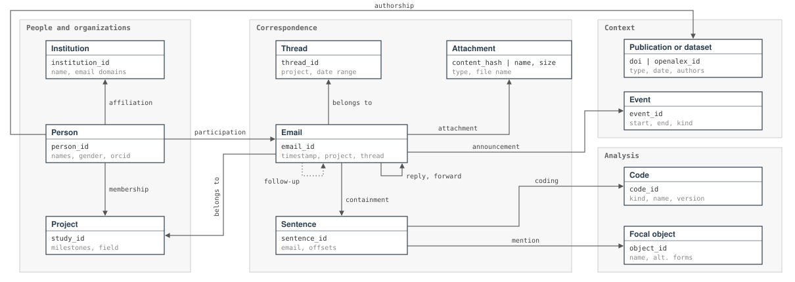
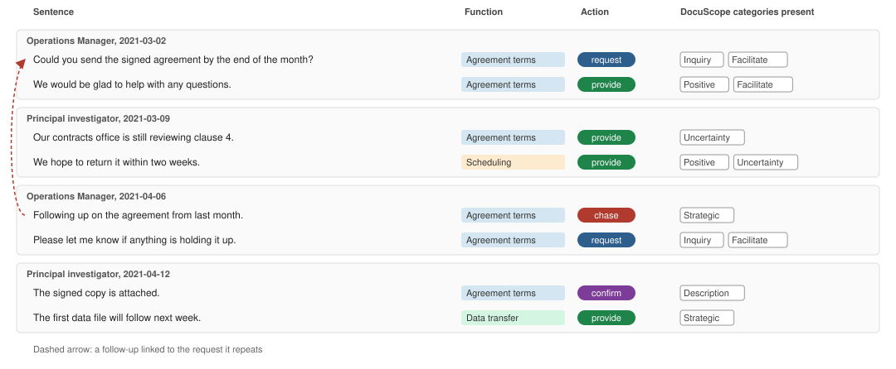
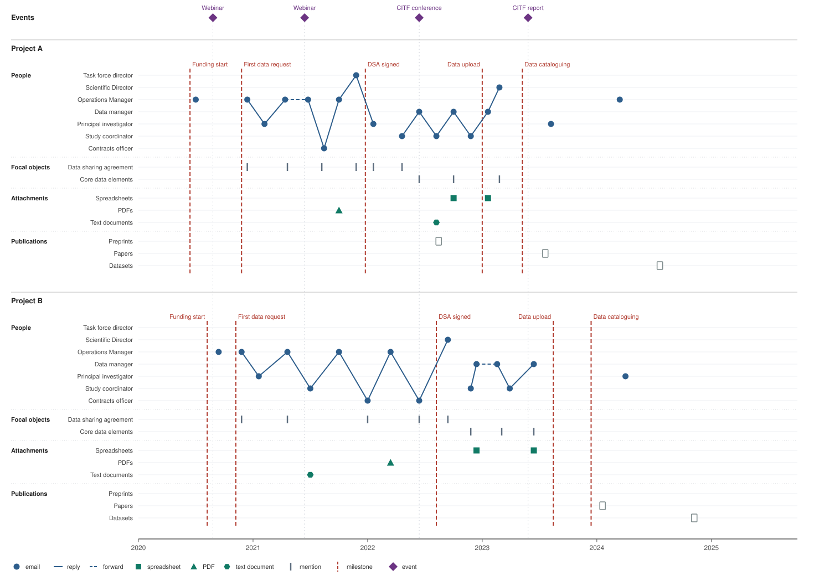
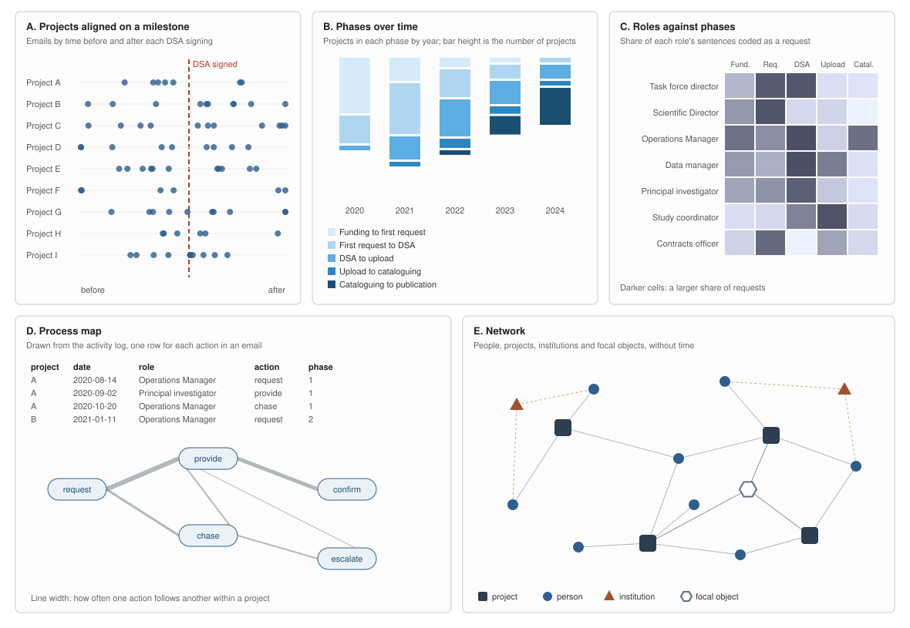

# Summary

Following the call on 13 November 2026 with David and Ian, we moved the CITF email work from tagging single emails to studying each project as a sequence of emails across its phases. We reorganize the work around that shift, toward the CIHR Project Grant application due March 3, 2027 (@sec-grant).

The work falls into four workstreams (@sec-workstreams). Preparing the corpus means building the study emails, their metadata, authored sentences and de-identified text into one corpus, with a graph of people, projects, focal objects and events around it. Coding rhetoric, functions and actions means labelling the authored text with three independent kinds of codes. Rhetoric now comes from rhetorical groups of the features that the Multi-Feature Tagger of English (MFTE) tags, with DocuScope kept as a comparison. Relating rhetoric, functions and actions means bringing the codes together, first with each other and then with role, phase and the course of each project. The grant application rests on the earlier applications and on this work.

The data sit in node and edge tables (@sec-model). We build every view from the node and edge tables, whether for close reading of one thread or for comparison across projects (@sec-views). The workstreams map onto folders in the `CITF-emails` repository (@sec-repo), and on 16 November we moved the corpus preparation out of the DocuScope assessment and into `corpus/`. The next steps are in @sec-next.

# Workstreams {#sec-workstreams}

The work falls into four workstreams. Preparing the corpus means producing the emails, zones, sentences, de-identified text, nodes and edges that the other workstreams use. Coding rhetoric, functions and actions means labelling the authored text, and relating rhetoric, functions and actions means comparing the three kinds of codes with each other, with the situation of each email and with the course of each project. The CIHR Project Grant application for Spring 2027 rests on the other three workstreams.

## Preparing the corpus {#sec-corpus}

The corpus is the table of emails, and the zones, threads, names and sentences attached to them, that we use in every other workstream. On 16 November we moved the corpus blocks of the DocuScope assessment notebook into `corpus/corpus.ipynb` and `corpus/tests/zoning/zoning.ipynb`. We still have to confirm, by hash, that a run of `corpus.ipynb` reproduces the earlier `email_zones.parquet` exactly.

**Objective.** Build one corpus for every other workstream, with every study email, its metadata and authored sentences, a de-identified copy for coding, and the graph of people, projects, objects and events around it.

**Deliverables.**

- Every study email with its dates, recipients and thread, and the emails it replies to or forwards
- Zones and sentences for every study email
- De-identified text with an offset map back to the raw body
- Project information and events
- Node and edge tables for correspondence, people and organizations, and context, with mentions and focal objects

### Study emails

The corpus begins with `msgs10` and `recip4`, the rawest form of the data available to us. Blocks that Melissa first wrote drop the duplicates flagged in `del_new`, join each message to its recipients, remove emails with identical content under different IDs, keep emails with a sender, a recipient and a body, and keep those linked to a valid study ID other than `200-NF`. That sequence takes 34,978 messages down to 10,397 study emails. Filtering out emails outside 300 to 2,000 characters and those that contain credentials leaves a pool of 6,086, and excluding automated notifications detected by sender address reduces the pool to 6,056. All 10,397 study emails stay in the corpus, each marked with the filters that remove it, so that we can state, for each analysis, which emails it uses.

Content patterns catch automated messages sent from personal addresses, such as out-of-office replies and ticket confirmations. We check each pattern against a sample of the emails it removes, in `corpus/tests/filters/`, so that, for instance, a reply quoting an out-of-office notice stays in.

We need to decide whether to code French emails in the original or to translate them, accepting that the tagged text then differs from what was sent. First we need to measure their share of the corpus, with a language detector run on the authored zone of each email.

### Email metadata

The flattened table has 5 of the 32 columns in `msgs10`, namely the message ID, study ID, sender address, cleaned subject and body, plus the To and Cc addresses from `recip4` as separate columns. The flatten step drops the dates, the sender's name and the flags, and without dates no email has a place in time. Restoring the dates, the sender's name and the flags is the first change to the corpus.

On 16 November we inventoried all 32 columns and their missingness to see what is recoverable. The dates are in `sent_datetime_rounded`, rounded to the minute, with 9.3% missing and no time zone recorded. No column holds reply, forward or message identifiers, and none holds attachments, so we take attachments from the attachment lines in the other zone. Ten flags whose names begin with `mt_`, such as `mt_dsa` and `mt_data_transfer`, and several other columns have no documented meaning, and we will ask Melissa what they record.

Threading joins emails into threads through their replies and forwards. Without identifiers, we join a reply to the email it answers through the normalized subject line, the quoted text and the timing. A forward starts a branch since it passes a message to someone outside the thread, and one email can reply to one message while forwarding another. Threading supplies the reply and forward edges in the data model (@sec-model) and the whole threads that we code for functions and actions. @yeh2006 reassembled Enron threads by matching each email's quoted text against earlier emails, and @jamison2013 and @dehghani2013 trained models to reconstruct email threads. We will research and test such models on the CITF emails.

### Zoning

Zoning divides each email into six zones. Chipmunk [@bevendorff2020] is a neural email segmenter trained on technical mailing lists. It classifies text into 15 segment classes, including code patches, log output and tables. Those 15 classes map onto five of the six zones defined for this project (@tbl-zones). The authored zone takes the paragraph, salutation and closing classes and holds the message the sender wrote, including greetings and closing lines. The signature zone takes the personal signature class and holds the sender’s name block and contact details. The banner zone takes the mail client signature class and holds text that an email client or institution appends to every message, such as “Sent from my iPhone” lines and confidentiality disclaimers. The quoted zone takes the quotation, quotation marker and inline header classes and holds the text of earlier emails that a reply or forward carries below the new message, along with the header lines that introduce each one. The other zone takes Chipmunk’s remaining seven classes, which cover headings, separators, tables and code, along with attachment lists and meeting invitations. The markup zone has no Chipmunk class and holds lines made up only of HTML tags, embedded image references, bare URLs and logo placeholders.

+-------------+------------------------------------------------------+----------------------------------+
| Zone        | What it holds                                        | Chipmunk classes                 |
+:============+:=====================================================+:=================================+
| Authored    | The new message the sender wrote, including          | paragraph, salutation, closing   |
|             | greetings and closing lines                          |                                  |
+-------------+------------------------------------------------------+----------------------------------+
| Signature   | The sender's name block and contact details          | personal signature               |
+-------------+------------------------------------------------------+----------------------------------+
| Banner      | Text that an email client or institution appends to  | mail client signature            |
|             | every message, such as "Sent from my iPhone" lines   |                                  |
|             | and confidentiality disclaimers                      |                                  |
+-------------+------------------------------------------------------+----------------------------------+
| Quoted      | The text of earlier emails that a reply or forward   | quotation, quotation marker,     |
|             | carries below the new message, with the header lines | inline headers                   |
|             | that introduce each one                              |                                  |
+-------------+------------------------------------------------------+----------------------------------+
| Other       | Headings, separators, tables, code, attachment lists | section heading, visual          |
|             | and meeting invitations                              | separator, tabular, technical,   |
|             |                                                      | raw code, log data, patch        |
+-------------+------------------------------------------------------+----------------------------------+
| Markup      | Lines made up only of HTML tags, embedded image      | None                             |
|             | references, bare URLs and logo placeholders          |                                  |
+-------------+------------------------------------------------------+----------------------------------+

: Zones, what each holds, and the Chipmunk classes that map onto them. {#tbl-zones}

We tested Okapi [@jardim2021], a multilingual extension of Chipmunk with Chipmunk's 15 classes, as an alternative email segmenter. Its authors released no trained model, so we rebuilt Okapi from the paper and trained it on the original training emails. On a test set of five CITF emails Okapi misclassified whole signature blocks as authored text, whereas Chipmunk did not. Chipmunk still errs on CITF emails, mostly by classing banners and disclaimers as authored text, or a whole signature as authored text when no closing precedes it. Five correction rules move those lines to the correct zone. Regular expressions then override Chipmunk's classes for markup lines, attachment and meeting lines, and banners, and send everything from the first reply or forward header onward to the quoted zone.

Zoning with Chipmunk, the correction rules and the regular expressions identifies authored lines with 98.7% precision and 97.1% recall, measured against an independent human coder working on a sample of 40 held-out emails. The 40 held-out emails all come from the pool of 6,056 emails of 300 to 2,000 characters. The full set of 10,397 study emails also includes short replies and confirmations, in which a two-line reply has few surrounding lines for Chipmunk to classify from. The full set also includes the longest emails, with long chains of earlier messages quoted below the reply. Each quoted message includes its sender's signature, and zoning has to place those signatures in the quoted zone. A second held-out check covers emails under 300 characters and over 2,000 from every project, which the coder codes by the same rules as in the first check. The tests comparing Chipmunk with Okapi and both held-out checks, with their scores, are in `corpus/tests/zoning/`.

### Segmentation

We split the authored zone of each email into sentences, and every code refers to them. Lists of variables, bulleted requests and sign-off names often end without sentence punctuation, so the splitting needs rules beyond punctuation to find where their sentences end. We mark the sentence boundaries in a sample of emails and compare the split sentences with the marked boundaries. The comparison is in `corpus/tests/segmentation/`. Each sentence has character offsets into the raw body. Codes from models that label longer stretches of text, such as whole emails, apply to every sentence in that stretch.

### De-identification

We use Presidio to replace personal information in the text that we read and label. Its recognizers cover personal names, email addresses and URLs, the same kinds of information that the topic modelling preprint [@batist2026] replaced with placeholders.

We assign each person one pseudonym across the corpus, so that anyone reading a thread can follow who writes to whom. A lookup table lists each person's email address and the names in the project information, and every entry for a person maps to that person's pseudonym. "Dr. Smith", "Jane" and her address therefore appear under one name. Pseudonyms contain no roles, since a role such as PI of a small study would identify the person. We keep roles in their own column beside the de-identified text, so readers still see each sender's role.

In an offset map, every position in the de-identified text has a matching position in the raw body, and every tag, code and zone refers to that one canonical text. `citf-emails` is public, and no email text goes into the repository, de-identified or not. The spans of replaced text and the offset map stay untracked beside `corpus.ipynb`.

The de-identification must satisfy the commitments in REB application 26-08-029-01 for the email corpus, and any name remaining in a greeting or a signature would appear in the de-identified text. We count the remaining names in a sample of emails, with extra short emails and French emails, where name recognition is least reliable. The check is in `corpus/tests/de-identification/`.

### Detecting actors, objects and events

We detect the actors, objects and events connected to each email beyond its sender and recipients. Actors are the people and institutions named in an email. Objects are the studies identified by ID or acronym, the focal objects referred to by name, such as the data sharing agreement and core data elements, and the files attached to the email. Events are moments and periods in a project's history, from a single meeting to several months, as they appear in the emails or the project information. Each detected actor, object and event becomes a node, each mention becomes an edge from the sentence that holds it, and each attachment becomes an edge from its email (@sec-model).

We find names with NER. spaCy's general English models cover people, organizations, places and dates. With them, "McGill University" and "COVID-19 Immunity Task Force" each come out as one organization, but the data sharing agreement, core data elements and study acronyms go unrecognized. We add patterns with spaCy's EntityRuler, which runs beside the trained model, and take the patterns for study IDs, acronyms, PI names, institutions and focal objects from the project information. The spans from NER and the patterns can replace the list of seven names in the `name` error rule of the DocuScope assessment, so that tags inside any detected name fall under that rule.

We identify people in the sender and recipient fields, in the authored zone with NER, and in the `crs` table, which lists 403 investigators and staff with their study IDs but only some of the people in the corpus. We link a name or address to a person only when it matches exactly one person, and we keep names that match no one in the Person node table, marked as unmatched. We assign each person a role in each email, since a person's role can differ from one email to the next. We identify institutions by name with NER and by email domain, and merge each domain with its institution's name, so that `mcgill.ca` and McGill University form one node.

We identify studies by the study IDs and acronyms listed in the project information. We identify each focal object by a set of patterns, such as "DSA", "data sharing agreement" and "the agreement" for the data sharing agreement. Short forms are ambiguous, since "the agreement" can refer to other agreements, and some mentions are pronouns, misspellings or French, so some mentions will go undetected and some detections will be wrong. Each attachment appears in the timeline with a shape for its file type (@sec-timeline). The files themselves may be missing from the archive, and without them we cannot use a content hash to tell when a file recurs.

A mass notification appears as the same message from one sender to many studies within minutes, and a webinar invitation appears in its subject line and dial-in lines. An absence appears in an out-of-office reply, with its start and end dates. Other events, such as meetings, deadlines and outages, appear in prose as a date or time expression near a word for what takes place, and we find them with NER's date and time entities and a word list. We date each event by the date in its text, or by the email's date when its text has none, and add events from outside records to the project information.

We check each kind of actor, object and event against a coded sample, with precision and recall for each, in `corpus/tests/detection/`. The detection output is a table of spans, with the email, the offsets, the text, the kind and the matched node for each, and it stays untracked beside `corpus.ipynb`, since the spans contain email text.

### Project information {#sec-project-info}

We compile project information to supply the context that each project's emails lack, and we place events on a calendar shared by all projects. The project information and the shared calendar together allow comparison of projects by field, institution, contracts officer, prior experience and later practice, as most of the integration questions require.

A project's information includes its study IDs and acronyms, the names and email addresses of its principal investigators and key personnel, its institutional hosts and affiliations, the publications and datasets from its CITF participation, and the profiles and ORCID iDs of its members. The `crs` table is the starting list. We take profiles and works from ORCID where people have them, works, co-authors, affiliations and dates from OpenAlex, and dataset DOIs from DataCite. Publications and datasets dated before a project's CITF participation are evidence of its members' fields and prior experience with data sharing, and co-authorship with the CITF core team or other data contributors is evidence of prior ties. We measure publications, datasets and co-authorship again after participation to see whether CITF work changed their data sharing and their collaborative networks.

Each of these steps involves a judgement, and we record each judgement in the project information. We cannot confidently match common names, or people who changed institutions, to an ORCID iD or an OpenAlex author. Deciding that a paper comes from a project's CITF participation means reading the paper. Many datasets have no DOI, and contracts officers and study coordinators rarely appear in bibliographic sources at all. Coverage will therefore differ by role and by field, and we record which projects each source covers. We also have to confirm that REB application 26-08-029-01, which covers the email corpus and the questionnaire, allows linking people in the corpus to public records.

A project's information also includes its milestone dates. Each marks a step in the project, such as the signing of a data sharing agreement or a data upload. A milestone occurs on a single date, but the work leading to it can span weeks or months.

We assign each email the phase between the milestones on either side of its date. Where a milestone is missing or its date conflicts with the others, the emails around it have no phase, and we flag the project. In analyses by phase, we leave those emails out and report how many.

We record a date for each event and, where possible, its reach, meaning the projects affected. We take webinar and conference dates from CITF records, mass notifications from detection in the corpus, and major reports and publications from the CITF's own outputs and from the wider literature on data sharing, including during COVID-19. Webinar attendance is not in the corpus, so we can compare emails around a webinar by timing alone.

We can compile the project information without any email text, in parallel with the rest of the corpus work.

## Coding rhetoric, functions and actions {#sec-coding}

The authored text of each email carries three kinds of codes. Rhetoric codes label how the text is written. They consist of rhetorical groups of MFTE features [@lefoll2025] and politeness strategies [@danescu2013]. Action codes label the act a writer performs in the text, such as a request or a confirmation [@cohen2004; @iso24617-2]. Function codes label the kind of task an act concerns in the data sharing work, such as obtaining ethics approval [@cohen2004; @iso24617-2]. Rhetoric codes come from MFTE's rule-based tags and ConvoKit's politeness strategies, and function and action codes from trained models. The three kinds of codes stay independent until the relating stage (@sec-relating), where they join on the sentence ID, so any association among them comes from the emails themselves.

**Objective.** Label the authored text of each email with rhetoric, functions and actions, and validate each kind of code before using it in the analysis.

**Deliverables.**

- Rhetorical groups and politeness strategies on the authored text, with the naming, sorting and stability checks behind them
- The DocuScope assessment's validation of each DocuScope category, for comparison
- Definitions of the function and action codes
- Function and action codes on the authored text from trained models, with tests of each model on the CITF emails
- Tasks of concern and the follow-ups among them

### Rhetoric

Rhetoric follows the workflow in [Deriving rhetorical groups from linguistic features](../rhetorical-groups/index.qmd), which rests on the lexico-grammatical and semantic features of MFTE's extended tagset [@lefoll2025] in the authored text. The CITF dimensions come from a factor analysis of which MFTE features co-occur across emails, with each feature adjusted for email length. Each pole of a CITF dimension with at least three features is a candidate rhetorical group, and a candidate becomes a rhetorical group when the name drawn from its most extreme emails passes a second reader's blind sorting check.

The rhetorical groups then face three tests. The first is their stability across random halves of the projects. The second is a comparison with Biber's 1988 dimensions [@biber1988]. The third is a canonical correlation analysis of the CITF dimensions against dimensions from a factor analysis of DocuScope categories, which @brown2022 used for the Enron emails.

ConvoKit's politeness strategies [@danescu2013; @chang2020] sit beside the rhetorical groups. Politeness theory defines them in advance, so no factor analysis lies behind them. The score and presence of each rhetorical group, and the presence and count of each politeness strategy, in the authored text are the input to relating rhetoric, functions and actions (@sec-relating), keyed by sentence ID.

### Functions

Function codes label the kind of task that the authored text concerns in the administrative process of data sharing, such as obtaining ethics approval or scheduling a meeting, and each kind recurs across projects. Trained models already exist for labelling workplace email by task or intent. For example, @sappelli2016 built classifiers for the tasks expressed in email, and @wang2019 built sentence-level intent models. We will research trained models that label email text by task and test how well they label the CITF emails before applying them in the analysis.

The text with each function code also belongs to a task of concern, meaning one instance of that kind of task in one project, such as one project's ethics approval, and we link the text about each task of concern across emails and threads. A follow-up is a later email in which the same sender returns to the same task of concern before any recipient replies. To tell one task of concern from another of the same kind, we will draw on the mentions detected in the corpus work, such as study IDs, focal objects, attachments and events (@sec-corpus). @ailon2013 grouped machine-generated emails by the user action that triggered them, which links emails beyond their threads in a similar way.

### Actions

Action codes label the act that a writer performs in the authored text, such as a request or a confirmation. Trained models already exist for labelling email by act. For example, @cohen2004 trained classifiers for email speech acts such as requests, proposals, deliveries and commitments, @mezza2018 trained dialogue act taggers on the ISO 24617-2 scheme [@iso24617-2], and @srivastava2023 trained event extractors on MailEx, a dataset of annotated email threads whose event types are forms of requesting, delivering and amending. We will research trained models that label email text by act and test how well they label the CITF emails before applying them in the analysis.

## Relating rhetoric, functions and actions {#sec-relating}

We relate rhetoric, functions and actions to one another and to the circumstances of each email and project, such as the sender's role and the project's phase.

**Objective.** Relate the three kinds of codes to each other, to the situation of each email and to the course of each project.

**Deliverables.**

- Comparisons of rhetoric by function and action, and a cross-tabulation of actions by function
- Mixed models relating the rhetoric within each function and action code to the situational dimensions
- A graph of each project, with the views across projects

### Relating codes to each other

We compare the three kinds of codes with one another to identify associations between rhetoric, acts and tasks in the CITF emails. The comparison follows form–function mapping, which links what a stretch of text does with how it is written [@biberconnorupton2007; @gray2020]. @gray2020 mapped dimension scores onto the parts of research articles in the same way, and @alafnan2018 found that workplace emails grouped by purpose fall in different registers.

For each coded stretch of text, the function and action codes stand for what the text does. The text's scores on the CITF dimensions, and the presence of each rhetorical group and politeness strategy in it, stand for how the text is written. We compare the mean scores on each CITF dimension across function codes and across action codes, as @biber1988 compared registers, and set the presence of each rhetorical group and politeness strategy in text with each code against all other text, controlling for length, as the [rhetorical groups note](../rhetorical-groups/index.qmd#sec-relate) sets out. From these comparisons we see, for example, whether requests score differently from confirmations on a CITF dimension, or whether one task draws more on a rhetorical group than another. We also cross-tabulate action codes by function code, to see which acts each task draws on.

The rhetoric that every instance of a function code shares belongs to the function itself, and the rhetoric that varies is the subject of @sec-relating-context. With every rhetorical group and politeness strategy paired with every function and action code, some differences will arise by chance, so we record the comparisons before the trained models label the corpus and correct for multiple comparisons.

### Relating codes to context {#sec-relating-context}

We relate the codes to the circumstances in which each email was written, first within each email and then across each project. We treat the situation of each email as a set of separate dimensions [@biber2020], namely the sender's role, the project's phase, prior contact between sender and recipient, follow-ups, whether a recipient sits in To or Cc, and the number of recipients, and relate the rhetoric that varies within a function or action code to each of them (@fig-comparison, panel E). Since each person writes in a register slightly their own [@grieve2023], and a few senders account for much of the correspondence, we fit mixed models with sender and project as random effects, which hold personal style apart from the function and action codes.

At the project level, we treat each project as a graph of the people, focal objects, attachments and emails involved in it, linked by who wrote to whom, what each email mentions, and which emails reply to, forward or follow up others (@fig-data-model). We explore each project's graph through its structure, such as who sits at the centre of its exchanges and who bridges projects (@fig-comparison, panel A); its paths from one email to the next through replies, forwards and follow-ups (panel B); the timing that dates on emails and milestones give those paths (panels C and D); and the focal objects that recur across its threads. We build each project's graph from the threads, the project information and the detected actors, events and focal objects (@sec-corpus), and add the action and function codes once the trained models label the corpus (@sec-coding).

## CIHR Project Grant, Spring 2027 {#sec-grant}

We are preparing a CIHR Project Grant application for the Spring 2027 competition, with David as nominated principal applicant. CIHR lists the competition on ResearchNet as 202703PJT, with registration closing February 3, 2027 and applications closing March 3, 2027. McGill's internal deadlines fall earlier than CIHR's. Ian reviews the draft before submission. We move the grant files out of `CITF-Postdoc` into `grant-writing/` before drafting begins ([Appendix A](#sec-grant-move)).

**Objective.** Submit a CIHR Project Grant application to the Spring 2027 competition that builds on the earlier applications and the work so far.

**Deliverables.**

- Settled integration questions
- The application, due March 3, 2027

### Grounding the proposal

We argue throughout the application that data sharing mandates ignore administrative overhead. In the preprint and the interviews, we describe that overhead, and with the email analysis we measure where and how it fell and how people wrote about it. For the methods, we relate rhetoric, functions and actions and draw on the project information, using each project's graph to tie emails to projects, milestones and events.

The application follows two earlier attempts. The Knowledge Translation Research committee reviewed an earlier Project Grant application, which CIHR did not fund, with reviewers questioning its fit to that committee, its methodological detail, its budget justification and its treatment of sex and gender. CIHR did not fund the March 2026 resubmission to competition 202603PJT either, and the study now has $100,000 from a related Priority Announcement grant in Pandemic Preparedness and Health Emergencies Research, competition 202603PPE. All reviewers of the March 2026 application raised consent for third parties in the email corpus, meaning the senders and recipients other than the mailbox holder, and reviewers again found that sex and gender sat in their own section and did not shape the methods. In the data model, gender is an attribute of each person, so every count can be broken down by gender (@sec-model). REB application 26-08-029-01 already justifies a waiver of consent under TCPS2 Article 5.5A, and we can answer the consent critique from that justification.

The application also draws on the work around the corpus. The phases, the milestones and the 395-day median from the first data request to the signing of the data sharing agreement (DSA) come from the topic modelling preprint. The interviews in `CITF-Postdoc` hold the accounts of the people who did the work. The DocuScope assessment covers what rhetorical tagging can and cannot support in these emails, and the rhetorical groups note covers how we derive rhetoric from linguistic features. With RDS-Review, the scoping review that updates @chawinga2019, with its protocol going to JMIR Research Protocols, we place the study in the literature on research data sharing. By March 2027, we aim to show with the prepared corpus that the methods work on these emails.

### Possible lines of inquiry

The application's rationale lies in the social and informational pain points of data sharing, and the analysis could pursue seven integration questions. Each question concerns how something about a project, its people or its moment shaped its emails and how people wrote them, so for each we need data beyond the email text. The questions are still at the brainstorming stage, and the approach under each is a first thought on how we could answer it with the related codes. Before any results arrive, we settle with David which questions the application takes up, and date and keep that decision in `notes/`, so that we fix the comparisons in advance and fewer pairings can turn up by chance.

1. **Did projects in different fields respond differently to the data sharing mandate?** Group projects by field and compare how long each phase took, with survival analysis on the time to each milestone, along with the rounds and follow-ups in each phase. At the sentence level, compare the actions and rhetoric of each field with mixed models that take study as a random effect. Sources: field from the project information.

2. **Did the webinars change how teams wrote, given that projects were at different phases?** Align each project's emails on each webinar date and compare a window before with a window after, separately for projects in each phase at the time. Compare the actions and rhetoric of the emails in each window and whether projects moved to the next phase sooner after a webinar. Attendance is unknown, so we can tie any difference to timing alone. Sources: webinar dates from CITF records, and phases from each project's milestones.

3. **Did contracts offices and officers shape how the agreement phase went?** Group projects by institution and by contracts officer and compare the time from the first data request to the DSA signing, the rounds with the contracts officer before signing and the share of the phase spent waiting on the institution. Where a contracts officer handled several projects, compare within that one person, and read that officer's exchanges closely to see whether the same objections recur. Sources: institutions and contracts officers from detection and the project information, and roles from participation.

4. **Did escalation by the task force director change what followed?** Find the emails the task force director wrote or received in Cc, and compare the time to the next milestone with projects at the same phase that had no escalation. At the sentence level, compare the actions and rhetoric of the emails just before and just after, from both the study side and the CITF side. Escalation follows trouble, so read each case closely for what prompted it. Sources: participation by role, and the threads.

5. **Where did projects stall, and what did stalling look like in writing?** Define a stall as a gap within a phase longer than usual for that phase, or a run of follow-ups without a reply, and mark each stall on the project's timeline. Use sequence analysis of each project's graph to find which paths through the phases include stalls. At the sentence level, compare the follow-ups with the emails they follow, and the emails inside a stall with those around it. Sources: the milestones, the threads and the follow-ups.

6. **Did prior data sharing experience or prior ties to the core team ease the process?** Measure the data each team shared and its co-authorship with the CITF core team and other data contributors before CITF participation, then compare phase durations and follow-up counts across the two measures. Read projects at both ends closely to see whether experience appears in the writing, for example in fewer clarifying questions about the agreement. Sources: the publications, datasets and co-authors from before CITF participation.

7. **Did CITF participation change teams' later data sharing and collaboration?** Compare each team's datasets and co-authorship after CITF participation with the same measures before it, and relate the change to how its CITF process went, by phase durations, stalls and escalation. We cannot separate the effect of CITF from trends in each team's field. Sources: the publications, datasets and co-authors from after CITF participation.

# Data model {#sec-model}

We organize the data as a graph of nodes and edges in four groups. Correspondence covers the emails and their parts, people and organizations cover who wrote and on whose behalf, analysis covers what coding and detection add, and context covers what comes from outside the emails. We store the nodes and edges as tables and write each table in the folder for the work it comes from, keyed by identifiers shared across every notebook. In `corpus/` we write the correspondence, people and organizations, and context tables, with mentions and focal objects; and in each coding folder, its Code nodes and Coding edges, with the follow-up edges in `coding/functions/`. People nodes include names, email addresses and gender, so we keep all the node and edge tables untracked beside their notebooks, as with the email text. The node and edge types appear in @fig-data-model, with lists in @tbl-nodes and @tbl-edges.

{#fig-data-model}

## Nodes

+---------------+--------------------+--------------------------------+--------------------------------------+
| Node          | Identifier         | Comes from                     | Main properties                      |
+:==============+:===================+:===============================+:=====================================+
| **Correspondence**                                                                                         |
+---------------+--------------------+--------------------------------+--------------------------------------+
| Thread        | Thread ID          | Thread stitching               | Project, date range, email count     |
+---------------+--------------------+--------------------------------+--------------------------------------+
| Email         | Email ID           | Study emails                   | Timestamp, project, thread, authored |
|               |                    |                                | zone, source IDs                     |
+---------------+--------------------+--------------------------------+--------------------------------------+
| Sentence      | Sentence ID        | Segmentation                   | Email, character offsets             |
+---------------+--------------------+--------------------------------+--------------------------------------+
| Attachment    | Content hash, or   | Attachment lines; detection    | Type, file name, size, pages;        |
|               | name and size      |                                | sheets, rows and columns             |
+---------------+--------------------+--------------------------------+--------------------------------------+
| **People and organizations**                                                                               |
+---------------+--------------------+--------------------------------+--------------------------------------+
| Person        | Person ID          | Email metadata; detection;     | Names, email addresses, affiliation, |
|               |                    | `crs` table                    | ORCID iD, gender with its source     |
+---------------+--------------------+--------------------------------+--------------------------------------+
| Institution   | Institution ID     | Detection; project information | Name, email domains                  |
+---------------+--------------------+--------------------------------+--------------------------------------+
| Project       | Study ID           | Emails; project information    | Study IDs, acronyms, milestone       |
|               |                    |                                | dates, field, hosts                  |
+---------------+--------------------+--------------------------------+--------------------------------------+
| **Analysis**                                                                                               |
+---------------+--------------------+--------------------------------+--------------------------------------+
| Code          | Code ID            | Code definitions; factor       | Kind of code, name, version          |
|               |                    | analysis of MFTE features;     |                                      |
|               |                    | DocuScope                      |                                      |
+---------------+--------------------+--------------------------------+--------------------------------------+
| Focal object  | Object ID          | Detection                      | Name and alternative forms           |
+---------------+--------------------+--------------------------------+--------------------------------------+
| **Context**                                                                                                |
+---------------+--------------------+--------------------------------+--------------------------------------+
| Publication   | DOI or OpenAlex ID | Project information            | Type (article or dataset), date,     |
| or dataset    |                    |                                | authors                              |
+---------------+--------------------+--------------------------------+--------------------------------------+
| Event         | Event ID           | Detection; project information | Start and end dates where known,     |
|               |                    |                                | kind, source                         |
+---------------+--------------------+--------------------------------+--------------------------------------+

: Node types, grouped by kind, with their identifiers, sources and main properties. {#tbl-nodes}

We group emails joined by replies and forwards into threads, so that we can code whole threads and count rounds within one.

We give each email an email ID of our own, assigned once and never reused. The message IDs in the source data, `msgid2` among them, have a complicated history, so we keep them as properties for tracing an email back to its source and use none of them as identifiers in the model. Every email belongs to one project.

Sentences come from the authored zone, with their offsets into the raw body. We attach codes and mentions to sentences.

We identify each attachment by a content hash, so that a file sent again, or under another name, remains one node. Where the file did not survive, we use the file name and size in place of the hash, and can detect recurrence only from those.

Gender is a property of each person. We take a person's gender from their own stated pronouns or profile where these exist, and otherwise from a probabilistic estimate by gender_guesser, keeping its probability. We record the source beside each value, so that we can break the counts down by gender and report how much of that breakdown rests on estimates.

A project is a CITF study, identified by the study ID in `msg_citfid`, which comes from subject lines. Its milestone dates are properties of the project. The topic modelling preprint defines six milestones that bound five phases, here called funding start, first data request, DSA signed, data upload, data cataloguing and data publication, where the preprint has "data introduction" for the second and "DSA execution" for the third. Each project reaches the milestones on its own dates, and a thread can cross one. We take a project's field from its publications and its hosts' departments, coding it once for each project.

We make codes nodes so that each code applied to a sentence can have its own record of where it came from.

Focal objects are the things that recur across a project's emails, such as the data sharing agreement, consent elements and core data elements, matched across threads and across projects. They have no date of their own and appear on the timeline only through the sentences that mention them.

Events range from a single day to a period of months, with start and end dates where known. They include webinars, mass notifications, the CITF conference, email outages, and major reports and publications on data sharing, generally and during COVID-19, by the CITF and from outside it.

## Edges

+---------------+-----------+------------------------------+--------------------------------------+
| Edge          | From      | To                           | Main properties                      |
+:==============+:==========+:=============================+:=====================================+
| **Correspondence**                                                                              |
+---------------+-----------+------------------------------+--------------------------------------+
| Reply         | Email     | Email                        | None                                 |
+---------------+-----------+------------------------------+--------------------------------------+
| Forward       | Email     | Email                        | None                                 |
+---------------+-----------+------------------------------+--------------------------------------+
| Containment   | Email     | Sentence                     | Position in the email                |
+---------------+-----------+------------------------------+--------------------------------------+
| Attachment    | Email     | Attachment                   | File name as sent                    |
+---------------+-----------+------------------------------+--------------------------------------+
| **People and organizations**                                                                    |
+---------------+-----------+------------------------------+--------------------------------------+
| Participation | Person    | Email                        | Sender, To or Cc; role in that email |
+---------------+-----------+------------------------------+--------------------------------------+
| Membership    | Person    | Project                      | Start and end dates                  |
+---------------+-----------+------------------------------+--------------------------------------+
| Affiliation   | Person    | Institution                  | Start and end dates                  |
+---------------+-----------+------------------------------+--------------------------------------+
| **Analysis**                                                                                    |
+---------------+-----------+------------------------------+--------------------------------------+
| Follow-up     | Email     | Email                        | None                                 |
+---------------+-----------+------------------------------+--------------------------------------+
| Coding        | Sentence  | Code                         | Character offsets for DocuScope tags |
+---------------+-----------+------------------------------+--------------------------------------+
| Mention       | Sentence  | Person, institution,         | Character offsets                    |
|               |           | project, focal object or     |                                      |
|               |           | event                        |                                      |
+---------------+-----------+------------------------------+--------------------------------------+
| **Context**                                                                                     |
+---------------+-----------+------------------------------+--------------------------------------+
| Authorship    | Person    | Publication or dataset       | Author position                      |
+---------------+-----------+------------------------------+--------------------------------------+
| Announcement  | Email     | Event                        | None                                 |
+---------------+-----------+------------------------------+--------------------------------------+

: Edge types, grouped by kind, with the node types they join and their main properties. {#tbl-edges}

Replies and forwards are the only edges that join emails into threads, and an email with neither forms a thread of its own.

We record role on each participation, since people change roles over the course of a project, a principal investigator in a small study may also act as coordinator, and a contracts officer may handle several studies at once. A person's participation may also matter beyond the email itself. When the task force director wrote to a project or received its emails in Cc, the question is whether the project's later emails changed, and we ask it of anyone whose presence may matter.

We attach mentions to sentences, so that a sentence that mentions the data sharing agreement has its rhetoric, functions and actions beside the mention. Mentions of other projects remain mentions, since each email belongs to one project.

A follow-up joins an email to the earlier email from the same sender on the same task of concern, with no reply from any recipient in between.

## Provenance

For every edge from matching, detection or coding, we record how it came about. For reply, forward, follow-up, participation and mention edges, we record the method and a confidence, where the method is the basis for the edge, such as a message identifier, a subject line, quoted text, a pattern, the NER model or a person. For coding edges, we record the source (a trained model, MFTE, ConvoKit or the DocuScope tagger), the model or definition version, a confidence and the date. We can then keep only the edges above a confidence threshold and report how many fell below it. One sentence can have codes from more than one model, and we compare them in the tests of each model.

# Views of the graph {#sec-views}

A view is a figure that lays out part of the graph for reading or comparison. We build every view from the node and edge tables. We use views within a project for close reading, and views across projects for comparison and for relating codes to context (@sec-relating).

## Within a project

### Thread view {#sec-thread}

{#fig-thread-view}

In the thread view (@fig-thread-view), one thread's emails appear in order, each under its sender's role and date, with every sentence of the authored zone beside its function, its action and the rhetorical groups present in it. A dashed arrow joins each follow-up to the email it follows. We use the thread view for close reading, to check whether a pattern in the counts holds up in the emails behind it. We also use the thread view as a visual check of the rhetorical groups, since each one appears beside its sentence. The text in the view is de-identified, and we keep the view untracked, as with the email text.

### Project timeline {#sec-timeline}

{#fig-timeline}

In the project timeline (@fig-timeline), the horizontal axis is absolute date, and the vertical space shows who and what. Each project lane has one row for each person in a role. The CITF side has the task force director, Scientific Director, Operations Manager and data manager, and the study side has the principal investigator, study coordinator and contracts officer. We place each email in its sender's row, so that a thread reads as an exchange between people, with chasing as repeated returns to one row and a stalled exchange as a long gap before the reply. The rows run from the CITF side to the study side without a divider, since we treat affiliation as an attribute of each person to compare in the analysis. We may add rows for other roles once the coding settles them.

Labels in the left margin group the rows into people, focal objects, attachments and publications. Each focal object has a row, with a tick at each email that mentions it. Attachments have one row per file type, with a mark at each email with an attachment of that type. Spreadsheets have squares, PDFs triangles and text documents hexagons. The properties table records which file is which and whether a file recurs. Publications from the project's CITF participation have one row per type, for preprints, papers and datasets, since datasets are direct evidence of data sharing.

Copied recipients remain in the participation edges, and we can mark them on the timeline when a question needs them. Once coding exists, we can also colour each email's mark by its actions.

Two invented projects, Project A and Project B, illustrate what the timeline makes visible. We chose an arc for each to that end.

**Project A** signs quickly after escalation and then reworks its data. Funding starts in mid-2020, and the Operations Manager writes once before the Databank's first data request near the end of that year. The negotiation runs between the Operations Manager and the principal investigator, with the data sharing agreement mentioned in most exchanges. In spring 2021 the Operations Manager forwards the thread to the contracts officer, who replies that summer, and the Operations Manager answers with a PDF attached, likely a draft agreement. In late 2021 the task force director writes to the project, and the project signs the DSA within weeks. The principal investigator replies just after the signing, so the thread crosses the milestone. The data work runs between the study coordinator and the data manager through 2022, with core data elements as the focal object. The coordinator sends a text document, and the data manager sends a spreadsheet, then sends a spreadsheet again early in 2023, just after data upload. The Scientific Director writes once at the end of that exchange, and cataloguing follows in spring 2023. The project posts a preprint during the data work, a paper in 2023 and a dataset in 2024.

**Project B** negotiates for nearly two years through the contracts office without escalation. Funding and the first data request come close together in late 2020. The Operations Manager writes to the principal investigator and then to the study coordinator, who sends a text document. From early 2022 the exchange moves to the contracts officer, who replies twice, with the Operations Manager sending a PDF in between. The task force director never writes. The project signs the DSA in summer 2022, and the Scientific Director writes shortly after. The data work is short. The study coordinator and the data manager exchange spreadsheets over about six months, the data manager forwards one message within the team, and upload and cataloguing follow in late 2023. The project publishes a paper and a dataset in 2024, with no preprint.

Both projects took more than a year to sign, for different reasons. Project A signed weeks after the task force director wrote. Project B took nearly two years, went through two rounds with the contracts officer, and nobody escalated. The topic modelling preprint reports a median of 395 days from the first data request to the DSA signing across studies, and from a median alone we cannot tell these two cases apart. From the order of senders we can.

Webinars fell during both negotiations, on dates shared by all projects, so we can set each project's emails before a webinar against those after it, whatever phase the project was in at the time.

## Across projects

{#fig-comparison}

### Network

Without time, people, projects, institutions and focal objects form one network (@fig-comparison, panel A). The network shows who connects projects, which focal objects recur across them, which institutions share contracts officers, and which people had ties before the CITF. It draws on participation, membership, affiliation, mention and authorship edges.

### Process map

Process mining takes a table of events, which we draw from each project's graph. The process map (@fig-comparison, panel B) draws the paths from one action to the next within each project, with the line width showing how often each transition occurs. Sequence analysis compares the paths across projects, and with the time to each milestone we can run survival analysis by field, institution or contracts officer.

### Projects aligned on a milestone

Each project's emails sit on a common axis of time before and after its own DSA signing (@fig-comparison, panel C), or any other milestone, so projects at different calendar dates line up. The view shows how activity, follow-ups and escalation gather around a milestone, and whether they gather differently by field or by contracts officer. It draws on the emails, the milestone dates and participation.

### Phases over time

The number of projects in each phase, year by year (@fig-comparison, panel D), shows where projects accumulated and when they moved on. We can place the events on the same calendar axis, though a coincidence between an event and movement shows only that they fell at the same time. The view draws on the milestone dates and the phase of each email (@sec-project-info).

### Roles against phases

A matrix of sender roles against phases (@fig-comparison, panel E) gives the share of each role's sentences that carry an action, a function or a rhetorical group, one code at a time. The matrix is the comparison view for relating codes to context, since it shows whether the codes follow the role, the phase or both. The matrix draws on the coding edges, participation with its roles and the phases.

## Practical considerations

A real project can hold hundreds of emails, with many people copied and several threads open at once, and a single timeline of it will be hard to read. Every view therefore filters, to one thread, one phase, one person or one focal object, and collapses people into their roles when individuals do not matter. The timeline leads into the thread view (@sec-thread), so that a pattern seen across a project can be read in the emails that make it.

Every edge and value has its method and confidence from the data model (@sec-model), and we draw the uncertain ones differently. Edges below the threshold appear faint, and we mark estimated gender as an estimate in every view. We describe the gaps in the data behind each view in the subsections of Preparing the corpus (@sec-corpus), and the limits on what comparisons show in Relating rhetoric, functions and actions (@sec-relating).

# Repository {#sec-repo}

```
citf-emails/
├── requirements.txt                # the environment for every notebook
├── data/                           # untracked: msgs10.csv, recip4.csv
├── corpus/
│   ├── index.qmd, sections/        # planned
│   ├── corpus.ipynb                # load, flatten, study emails, zones; planned: sentences, de-identification, detection
│   ├── threading.ipynb             # planned: threads, replies and forwards
│   ├── project-information.ipynb   # planned: projects, people, publications, events
│   └── tests/
│       ├── zoning/
│       ├── filters/                # planned
│       ├── segmentation/           # planned
│       ├── de-identification/      # planned
│       ├── detection/              # planned
│       └── threading/              # planned
├── coding/
│   ├── rhetoric/
│   │   ├── index.qmd, sections/    # planned
│   │   ├── rhetoric.ipynb          # DocuScope tags and their distribution; planned: MFTE, politeness, factor analysis
│   │   └── tests/
│   │       ├── docuscope/          # the DocuScope assessment
│   │       ├── mfte/               # planned
│   │       ├── naming/             # planned
│   │       ├── stability/          # planned
│   │       └── biber-dimensions/   # planned
│   ├── functions/                  # planned
│   │   ├── index.qmd, sections/
│   │   ├── functions.ipynb
│   │   └── tests/
│   └── actions/                    # planned
│       ├── index.qmd, sections/
│       ├── actions.ipynb
│       └── tests/
├── relating/                       # planned
│   ├── index.qmd, sections/
│   ├── codes.ipynb                 # codes with each other
│   ├── context.ipynb               # context, project graphs
│   └── views.ipynb                 # thread view, timelines, comparisons
├── notes/
│   ├── index.qmd                   # listing of the notes
│   ├── relating-rhetoric-to-functions/
│   ├── shift-to-supervised/
│   ├── study-design/               # this document, with its own .gitignore
│   └── rhetorical-groups/          # the rhetoric workflow
├── grant-writing/                  # planned: private repository, untracked
└── private/                        # untracked
```

There is one folder per workstream. `data/` holds only the raw data, `msgs10.csv` and `recip4.csv`. `corpus/` holds the corpus for every workstream, since project information, threads, attachments and mentions of focal objects are data we use directly in several analyses. `corpus.ipynb` loads `msgs10.csv` and `recip4.csv` from `data/`, flattens the emails, restricts them to study emails and zones them, and later blocks will add sentences, de-identification and detection. The planned `threading.ipynb` stitches threads and records replies and forwards, and the planned `project-information.ipynb` compiles projects, people, institutions, publications and events. Block 3 of `corpus.ipynb` now marks the pool with the length filter, without using it to define the corpus, and we will extend zoning to all 10,397 study emails.

Every output sits beside the notebook that writes it, and each notebook saves what later notebooks read. `corpus.ipynb` saves the study emails and `email_zones.parquet`, and `rhetoric.ipynb` saves the tags. The root `.gitignore` lists `/data/`, `*.csv` and `*.parquet` and already lists `*.html`, so the repository holds no email text and no output.

`coding/` holds one folder for each kind of code. `coding/rhetoric/` holds `rhetoric.ipynb`, which tags the pool with DocuScope and counts the tags, and will also tag every authored sentence with MFTE and ConvoKit's politeness module and run the factor analysis. The DocuScope assessment moved from `docuscope-assessment/` to `coding/rhetoric/tests/docuscope/` on 16 November, with its write-up and `docuscope.ipynb`, and `coding/rhetoric/tests/` will add `mfte/`, `naming/`, `stability/` and `biber-dimensions/` for the checks in the rhetorical groups note. We will add MFTE, ConvoKit, factor_analyzer and pybiber to `requirements.txt`. `coding/functions/` and `coding/actions/` each hold their own notebook, code definitions and model tests. `relating/` holds one notebook for relating codes to each other, one for relating codes to context, which also builds the project graphs, and one for the views.

Each notebook numbers its blocks from 1, and @tbl-blocks shows where each block of the former assessment notebook went on 16 November. The notebook headings and the assessment's sections carry the new numbers, and the About text of `docuscope_coding_tool.html` will carry them once we regenerate the coding tool.

| Former block | Now |
|:--------------------------|:----------------------------------------------|
| 1 Load email data | `corpus.ipynb` block 1, reading `data/` |
| 2 Flatten emails | `corpus.ipynb` block 2, with the dates, the sender's name and the flags still to restore |
| 3 Restrict to study emails | `corpus.ipynb` block 3 |
| 9 Label lines with Chipmunk | `corpus.ipynb` block 4, to extend over all study emails |
| 10 Refine zones | `corpus.ipynb` block 5 |
| 11 Zone check sample | `zoning.ipynb` block 1, in `corpus/tests/zoning/` |
| new | planned: `corpus.ipynb` blocks 6 to 8, for sentences, de-identification and detection |
| 4 Install DocuScope | `requirements.txt` |
| 5 Tag email bodies | `rhetoric.ipynb` block 1 |
| 8 Distribution of tags | `rhetoric.ipynb` block 2 |
| 6 View tags in an email | `docuscope.ipynb` block 1 |
| 7 Export 30 tagged emails | `docuscope.ipynb` block 2 |
| 12 Detect likely tagging errors | `docuscope.ipynb` block 3, reading tags from `rhetoric.ipynb` and zones from `corpus.ipynb` |
| 13 Comparison across tag versions | `docuscope.ipynb` block 4 |
| 14 Validation (planned) | planned: `docuscope.ipynb` block 5 |

: Blocks of the former assessment notebook and where each one went on 16 November. {#tbl-blocks}

The coding sample keeps its seed, so block 3 of `docuscope.ipynb` regenerates the same 774 tags with new block numbers in the coding tool.

Workstream notebooks hold the final methods, and each `tests/` folder holds the trials and checks on them, with one subfolder per check and the write-up in that subfolder's `sections/`. A test reads the workstream's outputs without copying its methods, and we move a rule that a test confirms into the workstream notebook. `corpus/tests/zoning/` holds the zoning checks, which cover the Chipmunk and Okapi tests on Gmane and Enron, the five CITF emails, the zone check of 80 emails and the held-out checks, and we moved the zoning appendix there from the DocuScope assessment. We will add to `corpus/tests/` the checks on the automated-message patterns, the sentences, the de-identification, the detection and the threading. `coding/rhetoric/tests/docuscope/` holds the DocuScope assessment, with the tag coding sample and the planned validation, and the `tests/` folders of `coding/functions/` and `coding/actions/` hold each test set and the comparison of SetFit with its baselines, with the MailEx test under actions. The test subfolder names are proposed labels.

`notes/` holds working notes, following `notes/` in `CITF-Postdoc`, with `notes/index.qmd` as the page that lists them. It also holds `relating-rhetoric-to-functions/` and `shift-to-supervised/`, which moved there from `private/`, and `rhetorical-groups/`, the note of 18 November that sets out the rhetoric workflow. The summary of the call and the transcript sit beside this document in `notes/study-design/`, as `_call-summary.qmd` and `_transcript.qmd`, which the site skips because of the leading underscore. A `.gitignore` of the folder's own lists both files, so both remain untracked if the folder moves, and the root `.gitignore` stays as it is. We leave the summary of the call and the transcript out of the published page, since both are personal records of the call, and include them in a local render with `-M call-appendices:true`.

The planned `grant-writing/` is its own private repository on the lab's git server, cloned into `citf-emails/grant-writing/` and listed in `.gitignore`. `citf-emails` is public on GitHub, so GitHub publishes every tracked file and every past version of it, and grant drafts, budgets and reviews cannot sit there. Since `.gitignore` lists it, `citf-emails` holds no trace of the grant repository, and I work in it as an ordinary repository. [Appendix A](#sec-grant-move) gives the steps to carry the grant work and its history over from `CITF-Postdoc`.

# Next steps {#sec-next}

The next steps continue work that began in December 2024 with the `CITF-Postdoc` site and its research, case selection, interview and ethics protocols. The REB approved the interview study's revised informed consent in March 2025, and from April 2025 to February 2026 I interviewed people involved in the CITF Databank and coded each interview, with an ethics amendment approved in June 2025 and the `qc` tools for reviewing the codes built in spring 2026. A CIHR Project Grant application drafted with David from July 2025 went in that September, alongside a fellowship application, and the Knowledge Translation Research committee did not fund it. I submitted an abstract to the CRDCN conference in February 2026. In March 2026 CIHR declined the resubmission to competition 202603PJT and funded a related Priority Announcement application to competition 202603PPE for $100,000, which now funds the study. I started the `CITF-Postdoc` manuscript on the interviews in June 2026.

Tanya and Melissa started cleaning the email data in April 2025. Melissa and I then used NMF topic modelling with LLM-generated topic labels for an initial exploratory look at the administrative process of data sharing across each study's lifecycle phases and sender roles. We wrote up that analysis as an [unpublished preprint](../../topic-modelling/index.qmd). In August 2026 I redrafted the research protocol for the email study around the revised work plan and submitted REB application 26-08-029-01 for the email corpus and the questionnaire, revising it after the pre-review comments in September. RDS-Review, the scoping review that updates @chawinga2019, began during a weekly call in early October 2026. Melissa's notebook, blocks 1 to 7, filtered `msgs10` and `recip4` to the 10,397 study emails, tagged them with DocuScope and exported the 30-email sample from which the DocuScope memo grew. By 12 November 2026 blocks 8 to 12 had counted the tags, zoned the emails with Chipmunk after a comparison with a rebuilt Okapi, checked the zones on 40 held-out emails, defined 13 error rules and drawn the 774-tag coding sample, and the DocuScope Assessment went onto the site that day. Block 13's findings followed on 13 November, the day of the call with David and Ian. On 16 November I split the assessment notebook into `corpus.ipynb`, `rhetoric.ipynb`, `docuscope.ipynb` and `zoning.ipynb`, with block 13 as block 4 of `docuscope.ipynb`, moved the notes, with this document, into `notes/`, set up a repository-wide environment, and inventoried the columns of `msgs10` and `recip4`. On 18 November I re-read Brown and Laudenbach and wrote the [note on deriving rhetorical groups](../rhetorical-groups/index.qmd).

1. **Finish the corpus move.** Restore the dates, the sender's name and the flags in `corpus.ipynb` block 2, ask Melissa what the unexplained columns record, reproduce `email_zones.parquet` by hash, regenerate the coding tool, and confirm whether `start` and `end` in `how_tags.parquet` are character or token offsets.
2. **Move the grant work** into `grant-writing/` ([Appendix A](#sec-grant-move)).
3. **Extend zoning** to all study emails and run the second held-out check.
4. **Split sentences and de-identify** the authored text, checked in `corpus/tests/segmentation/` and `corpus/tests/de-identification/`.
5. **Compile project information and events** in `project-information.ipynb`, from the `crs` table, signatures, ORCID, OpenAlex, DataCite and CITF records.
6. **Detect actors, objects and events,** with patterns from the project information, checked in `corpus/tests/detection/`.
7. **Write `threading.ipynb`.** Stitch threads and record replies and forwards, checked in `corpus/tests/threading/`.
8. **Settle the integration questions** (@sec-grant) with David, dated, in `notes/`.
9. **Continue the DocuScope assessment** with the thresholds, the coding of the tag sample and the validation block.
10. **Run the rhetoric workflow** in `coding/rhetoric/`, following the steps in the [rhetorical groups note](../rhetorical-groups/index.qmd#sec-rg-next).
11. **Start coding functions and actions,** each in its own folder, on whole threads drawn by project and phase.
12. **Build the project graphs** in `relating/context.ipynb` and draw the thread views and project timelines.
13. **Draft the grant's methods** for Ian's review, registering by February 3 and submitting by March 3, 2027.

We take step 1 before the rest of the corpus work, and steps 8 and 9, with the first three steps of the rhetoric workflow, alongside steps 2 to 7.

# Links and references {#sec-refs .unnumbered}

## Links {.unnumbered}

- `citf-emails` repository: <https://github.com/zackbatist/CITF-emails>
- `citf-emails` site: <https://zackbatist.info/CITF-emails/>
- `en_docusco_spacy` model page: <https://huggingface.co/browndw/en_docusco_spacy>
- Deriving rhetorical groups from linguistic features: <https://zackbatist.info/CITF-emails/notes/rhetorical-groups/>
- MFTE code and documentation: <https://github.com/mshakirDr/MFTE>
- ConvoKit politeness strategies: <https://convokit.cornell.edu/documentation/politenessStrategies.html>
- factor_analyzer: <https://github.com/EducationalTestingService/factor_analyzer>
- pybiber documentation: <https://browndw.github.io/pybiber>
- DocuScope tags (full dictionary): <https://browndw.github.io/docuscope-docs/tagsets/docuscope-fd-tags.html>
- Chipmunk code and annotations: <https://github.com/webis-de/acl20-crawling-mailing-lists>
- Presidio: <https://github.com/data-privacy-stack/presidio>
- spaCy EntityRuler: <https://spacy.io/api/entityruler>
- small-text: <https://github.com/webis-de/small-text>
- SetFit: <https://github.com/huggingface/setfit>
- MailEx code: <https://github.com/salokr/Email-Event-Extraction>
- CIHR Project Grant program: <https://cihr-irsc.gc.ca/e/49051.html>

## References {.unnumbered}

::: {#refs}
:::

# Appendix A: Migrating prior grant-writing activity {#sec-grant-move .unnumbered}

`CITF-Postdoc` tracks three submodules on the lab's git server, namely `data`, `private` and `qc`. The public repository's history holds no grant drafts, so the grant work most likely sits in the `private` submodule, which I update every few days. The procedure consists of extracting the grant folder with its full history into a new private repository and cloning that repository into `citf-emails` as `grant-writing/`. We find the path of the grant folder in step 1 and use it in steps 2 to 6.

1. **Find the folder.** List every path the `private` repository has ever held, to identify the grant folder and to check what its history contains. Run this on the server:

   ```
   cd ~ && git clone <address of the private repository> private-scan && cd private-scan && git log --all --name-only --format= | sort -u | cat
   ```

   The output identifies the grant folder. Every past version of every file in the grant folder will move with the folder, so the list also shows whether anything should be left behind.

2. **Install git-filter-repo** into `~/citf-emails-env`.
3. **Extract the folder.** In a fresh clone of `private`, `git filter-repo` keeps only the grant folder, moves its contents to the root, and keeps every commit that touched it with its original date and message.
4. **Create the private repository** on the lab's git server and push the extracted history to it. The name `citf-emails-grant` is my label.
5. **Clone the new repository into `citf-emails`** at `grant-writing/`, and add `grant-writing/` to `.gitignore` and `"!grant-writing/"` to the render list in `_quarto.yml`.
6. **Remove the folder from `private`** once `grant-writing/` checks out with its full history, with a commit naming its new location.

::: {.content-visible when-meta="call-appendices"}

:::

::: {.content-visible when-meta="call-appendices"}

:::